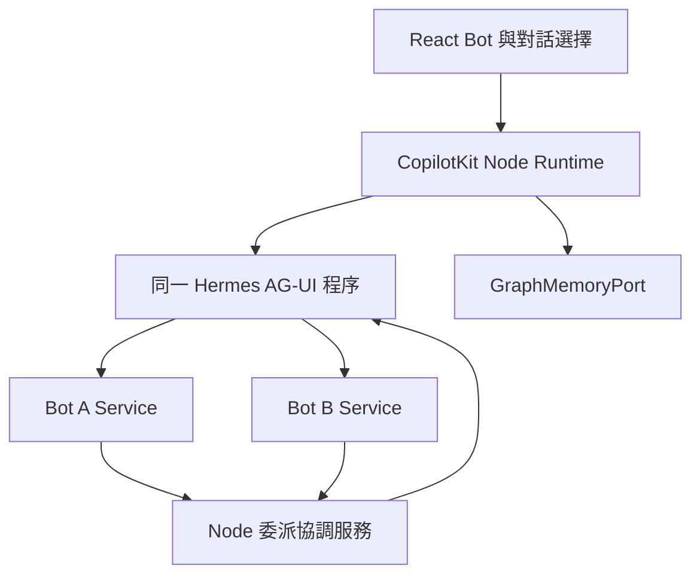

# Hermes Multi-Bot × CopilotKit 實作計畫

適用專案 [jiangweitaiwan/hermes_agui](https://github.com/jiangweitaiwan/hermes_agui)  
執行對象 Codex CLI  
基準參考 commit `c83d555d848a2a84d0bfd3a5f25501c602382915`，實作以使用者目前 checkout 為準

## 1. 起點與交付範圍

使用者已驗證 Hermes AG-UI 可獨立部署及呼叫，CopilotKit Runtime 可轉接 Hermes，React UI 可操作。直接開工。開始時記錄 checkout 與既有改動，核對相關符號、生命週期及測試入口。沿用已驗證的啟動設定，於改動處執行必要回歸。

| 已有能力 | 本期擴充 |
|---|---|
| FastAPI AG-UI HTTP/SSE 和 Docker 封裝 | 一個 Python 程序、單一 ASGI worker，承載兩個以上 Bot Service |
| 固定 trusted principal/profile 的 `HermesAgentService` | 每個 `bot_id` 綁自己的 Service、profile、workspace 和存取規則 |
| Hermes 原生 SQLite history、receipts、取消及 HITL | 依 Bot 定位所有執行與續接操作 |
| CopilotKit 註冊一個 `hermes`，前端依 Thread 切換 | 註冊多個 agent，先選 Bot 再選該 Bot 的 Thread |
| 原生 Hermes Tools、Memory、Skills、Context | 新增 Bot 委派工具及 CopilotKit 應用後端的 graph 記憶接口 |

最終驗收是使用者能分別呼叫兩個 Bot，兩個 Bot 能受控互相委派短任務，CopilotKit 應用後端能掛接未來的 graph 記憶服務。本期 graph 只交付接口、停用狀態和測試替身。跨重啟委派、背景排程、分散式 worker、完整 UI 歷史恢復及跨重啟 HITL 屬後續範圍。

[原計畫](https://github.com/jiangweitaiwan/hermes_agui/blob/c83d555/IMPLEMENTATION_PLAN.md) · [Phase 4 Session 與授權](https://github.com/jiangweitaiwan/hermes_agui/blob/c83d555/docs/phase-4-report.md) · [Phase 6 原生能力](https://github.com/jiangweitaiwan/hermes_agui/blob/c83d555/docs/phase-6-report.md) · [Phase 7 HITL](https://github.com/jiangweitaiwan/hermes_agui/blob/c83d555/docs/phase-7-report.md) · [Phase 8 部署](https://github.com/jiangweitaiwan/hermes_agui/blob/c83d555/docs/phase-8-report.md)

## 2. 目標架構

- `bot_id` 是長期身分，從服務端設定解析。CopilotKit agent key 對應 `bot_id`。Python 授權同時驗證呼叫身分、目標 Bot 和 Thread 範圍。
- `threadId` 是 Bot 內的對話識別。執行隔離至少涵蓋 `(bot_id, principal, threadId)`；索引、cache、active run、cancel、resume 和既有 receipts 都須審核這一點。不同 Bot 可安全使用相同 thread、run 或 message ID。
- `runId` 是一次 AG-UI 執行識別。保留現有 SDK 格式與 SSE 相容性。Node runner 若以 thread ID 全域索引，使用與 Bot 綁定的 runtime thread key，並對查找、停止、恢復和事件映射採用同一策略。
- 原生 SQLite 保留模型歷史權威。前端顯示的 transcript 依既有 adapter 規則處理。每 Bot 使用不同 canonical profile 路徑、工作目錄及資料卷，設定對應的 `terminal.cwd`。同程序共享 OS 權限，profile 隔離是應用層隔離。共用程序原型只用可信 Bot 與相容的工具權限。

## 3. 里程碑 A — 單一 Python 程序承載多 Bot

1. 從 `hermes_agui/server.py`、`adapter.py`、`core/service.py`、`session_manager.py`、`receipts.py` 和 `human_input.py` 追現有建構、授權與清理。擴充一個 host 管理多個 Bot 的 Service 與既有 per-Bot HTTP 執行狀態。優先重用共通 handler 和同一 FastAPI lifespan。
2. 加入服務端 Bot 設定。以 `researcher`、`reviewer` 作範例，配置 profile、workspace、可信 principal、既有 provider/tool 設定與服務憑證來源。啟動時驗證重複 ID、實際路徑碰撞及必要欄位，初始化失敗時關閉已啟動的資源。憑證由環境或既有 secret 機制供應。
3. 新增 `POST /bots/{bot_id}/agent`，取消使用 `POST /bots/{bot_id}/threads/{threadId}/cancel`，resume 送到同一 Bot 的 agent endpoint。維持 `GET /health`。保留既有單 Bot `POST /agent` 和取消路徑及其舊 profile 歷史相容性；多 Bot 模式的 legacy 路徑只在明確設定 default Bot 時可用。
4. 每 Bot 維持既有同 Thread busy、receipt、SSE disconnect 與 HITL 語意。新增 host 層整體並發上限，保留 per-Bot 上限，並正確釋放完成、失敗、逾時、取消及 shutdown 的資源。確認 profile scope 沿原生建構、工具執行、eviction、shutdown 傳遞，Bot 設定由可信 host 供給。
5. 更新現有 Python 映像／部署範例，讓同一容器掛載各 Bot 的持久目錄並啟動一個 AG-UI host。

**驗收**：兩個 Bot 同時使用完全相同的 thread/run/message IDs 各執行一次並延續自己的歷史；相同 Bot 的重送仍依既有規則拒絕。A 的憑證無法操作 B，取消或 resume A 只影響 A，角色、Skills 和記憶讀取各自的 profile。程序重啟後以同一路徑恢復各 Bot 歷史；原有單 Bot 契約通過。用 loopback fake provider 驅動真實 Hermes loop 及 HTTP 驗收。

## 4. 里程碑 B — CopilotKit 路由與 Web UI

1. 從 `examples/copilotkit/server/runtime.ts` 及 `server/index.ts` 擴充可信 agent 註冊設定。為每個 Bot 建立既有模式的官方 `HttpAgent`，路由至同一 Python host 的不同 Bot 路徑。每個 token 留在 Node；瀏覽器送出 Bot 身分，由伺服器解析目標 URL、憑證及可用 Bot。
2. 檢查已鎖定 CopilotKit runner 的 Run、stop、resume 與 thread key 行為。將 Bot 綁定帶到整條請求鏈，保留既有 metadata 過濾及 SSE 行為。
3. 在 `frontend/main.tsx`、`ThreadChat.tsx` 檢查並移除單一 agent key 假設。提供 Bot 清單、Bot 下的 Thread 清單、切換與新增對話。對話元件、hooks、訊息與等待人工輸入的 UI 全部使用 Bot + Thread 範圍。沿用現有 loopback 單使用者部署作為首版。

**驗收**：Playwright 同時對 A、B 送不同任務。來回切換時，串流、工具事件、錯誤及 HITL 出現在正確的 Bot/Thread；可以停止 A 而 B 繼續。同一 Bot 的兩個 Thread 可維持各自上下文。保留現有單 Bot 測試並執行 TypeScript production build。

## 5. 里程碑 C — Bot 互相委派

1. 在 Node 應用後端新增內部委派協調服務，並以原生 Hermes 工具機制暴露 `message_bot(target_bot_id, task)`。由可信 host 綁定來源 Bot、Thread 與 Run；模型只選目標和任務文字。Node 以服務間認證、方向性 allowlist 及來源身分驗證委派。
2. 協調服務建立 `delegation_id`、子 `threadId` 和子 `runId`，記錄父子關聯。透過目標 Bot 的 AG-UI endpoint 建立獨立 Run，消費 SSE 並回傳有界的最終文字與狀態。依 terminal outcome 判斷完成、失敗或需人工處理。A 收到的是原生 tool result，接續自己的 agent loop。B 只取得明確交辦的資料。
3. 首版採有時限的同步委派，每次執行允許一層。A → B 與 B → A 可各自從獨立的根 Run 發起。入站子 Run 由可信執行資訊標明已委派，深度限制須由服務端強制。使用同程序的真實並發測試，確認父 Run 等待期間目標 Bot 有可用 worker；容量不足立即返回可判讀錯誤，避免父子互等。
4. 定義逾時、父 Run 取消、目標忙碌、目標 HITL、結果過大與重複呼叫的結果。父取消或逾時時終止子串流並發出合作取消。子 Run 進入 HITL 時，首版取消子執行並回報需人工處理。以可信父 Run 與 tool call 識別做程序內去重。斷線和程序重啟後的耐久委派由未來的持久化 worker 承接。

**驗收**：A、B 各自可直接接任務；A → B 和 B → A 各有一筆成功案例。確認子 Run 擁有獨立歷史與 ID，輸出回到正確的父 Run。測試拒絕未授權、子 Run 再委派、逾時、取消、容量不足與重送。以同一 Python host 和真實 Node 協調服務跑完整委派路徑。

## 6. 里程碑 D — CopilotKit 開放 graph 記憶接口

在 Node 應用後端實作可注入的 TypeScript `GraphMemoryPort`，在 Runtime 的啟動組裝處提供 provider 設定。這是供未來 graph adapter 掛接的 server-side API。實作者先定義具型別的請求、結果與錯誤，再以 in-memory 測試替身證明呼叫能到達 provider；預設部署回報 `disabled`。本期到接口層即可，產品 Run 自動檢索與模型工具接入排入 graph 實作階段。

| 介面 | 契約 |
|---|---|
| `query(scope, request)` | 接收查詢文字與有界 limit。回傳 `ok`（含 hits）、`disabled` 或 `unavailable`。空 hits 代表成功但沒有匹配。 |
| `write(scope, entry)` | 接收有界內容、可見範圍、來源與 idempotency key。回傳 `accepted`（含 record ID）、`disabled` 或 `unavailable`。未授權或格式錯誤走明確拒絕。 |
| `scope` | 由受信任後端建立，攜帶 principal、botId、projectId，及目前的 threadId/runId。 |
| `entry` 與 `hit` | 至少保留內容、來源 Bot/Thread/Run 與可見範圍。可見範圍先定義 Bot 私有及同專案共享。 |

接口入口先驗證 scope、權限、輸入大小和超時，provider 查詢仍必須按 scope 過濾，回傳資料再檢查可見範圍。保留 provider 替換點與最小使用範例。若未來需要外部服務存取，再從此接口加經認證的內部 HTTP adapter。本期不用新增公開路由、graph DB、schema、embedding、資料抽取或持久化。現有 `hermes_agui/message_adapter.py` 拒絕非空 AG-UI `context`、`state` 與前端工具宣告，未來接入模型時由受信任的後端工具或明確的注入路徑承接。

**驗收**：預設停用時，既有對話與委派能執行。注入測試 provider 後，Node 應用後端可依正式契約 query/write，一筆專案共享假資料可被同專案的另一 Bot 查得，私有與跨專案資料受範圍限制。驗證 disabled、空結果、拒絕及 provider 逾時各走預期路徑。測試替身只在測試中使用。

## 7. 部署與交付

- 更新部署指南與範例設定。記錄同一 Python 容器的 Bot 設定／資料卷、Node 的 endpoint 映射／啟動方式，以及瀏覽器操作。以兩個 Bot 的固定範例讓使用者能按文件重現。保留既有 AG-UI 與 CopilotKit 的環境變數語意，新增變數列入範例。
- 完成 A → B → C → D 的依序交付。每一里程碑以最小改動重用原生 agent loop、工具註冊、歷史與 HITL。測試採既有 fake provider 和 Playwright fixtures；明確列出通過、失敗和因環境而未執行的項目。
- 最終展示流程為「啟動一個 Hermes AG-UI host 和一個 Node Runtime → UI 各自交辦 A、B → A 委派 B 並拿到結果 → graph 接口的契約測試通過」。若當前環境已配置真實 provider，可補跑此部署路徑的 smoke test。始終以 fake-provider 自動化結果與真實 provider 的實測結果各自記錄。
- 最終回報列出變更檔案、測試命令與結果、部署步驟、介面契約及留待下一期的工作。下一期從實作 graph provider 和決定記憶觸發時機開始。

