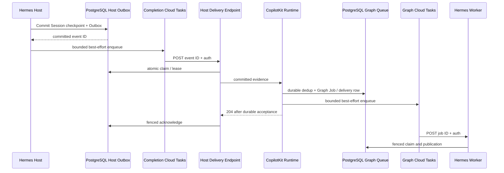

# Hermes AG-UI — Event-driven Execution & Scheduled Reconciliation

## 0. 實作指示（Codex）

- Repository: `jiangweitaiwan/hermes_agui`
- 基準 commit: `4fffc212dc1d8effd38e0e503d9381556195a5f0`。
- 建議工作分支：`codex/event-driven-execution`，從包含上述基準的已審核版本建立；先確認 ancestry、工作樹及最新差異，不覆蓋其他工作。
- 本計畫為單階段交付；完成 source、部署模板、關鍵測試及工作報告，不要求真實 GCP staging 或全量 E2E。
- 不得自行 Push main、修改 production GCP/DB、清空資料、執行 production migration 或變更真實排程；由操作者完成一次性 provisioning 後才正式部署。
- 優先重用現有 Outbox、Dispatcher、Graph Queue、Cloud Tasks、Migration Framework 和 database-aware rollout。本文的新增檔名與 API 名稱是目標契約，若實際入口不同，以追蹤到的 source 為準並在報告說明。

## 1. 目標與範圍

正常 Session 完成後立即觸發 Completion Delivery，再由 Runtime 觸發 Graph Memory Ingest；Scheduler 僅作低頻 reconciliation，無人使用時不需要常駐 poller。保留 PostgreSQL 作為唯一可信工作狀態，Cloud Tasks 是可重複投遞的通知層。維持 at-least-once delivery 與業務結果冪等，不宣稱跨 PostgreSQL、GCS、Cloud Tasks exactly-once。

保留 3 個 Cloud Run Services、4 個 Cloud Run Jobs、3 個 Scheduler；新增一個 Completion Cloud Tasks Queue，沿用既有 Graph Queue。不新增 Pub/Sub、Eventarc、Redis 或常駐服務。不改 Graph Memory 的 Parser/Retriever/LLM Prompt、Bot UX、LLM Management Contract 或 Session 儲存設計，除非本功能必要的最小介面調整。

成功條件：無 Scheduler 介入也能完成正常 ingest；enqueue 失敗/崩潰仍可恢復；空閒沒有持續輪詢；部署不依賴低頻排程；不破壞既有 DB release、歷史資料與安全 fence。

## 2. 現況盤點（基準版本）

| 元件 | 基準行為及改造點 |
|---|---|
| `hermes_agui/storage/run_outbox.py` | `claim()` 取得最早可用事件、`acknowledge()` / `retry()` 依 attempts 和 lease fencing 更新；擴充指定 ID 的原子 claim。 |
| `hermes_agui/storage/completion_delivery.py` | `GraphCompletionDispatcher` 從 GCS 讀 committed evidence，POST Runtime `/internal/graph/completions`，204 才視為成功；CLI `--once` 只處理一筆，預設為無限迴圈。 |
| `hermes_agui/storage/run_events.py` | `RunEvents.reconcile()` 修復逾期 Run。 |
| `examples/copilotkit/server/graph/tasks.ts` | Runtime 已有 Cloud Tasks enqueue 和 reconciliation；Graph job/delivery row 是權威，成功 enqueue 後 next_delivery 延後 10 分鐘。 |
| `examples/copilotkit/server/worker-http.ts` | `/internal/jobs/process` 及 `/internal/jobs/reconcile`，Cloud Run IAM 加 `x-worker-token`。 |
| `scripts/ci/database_rollout.py` | Fence → 被動 drain → pause Scheduler → 停止服務 → 再次 drain → migration/release；目前未管理 Cloud Tasks Queue。 |
| `examples/copilotkit/server/storage/deployment-operations.ts` | drain 查 Host running runs、pending/leased outbox、pending/running graph jobs；目前等待上限 300 秒。 |

先追蹤真實 Host checkpoint/commit、HTTP routing、cloud storage adapter 和 Runtime completion transaction，再定位 hook；不得在 evidence staging 或未提交的 transaction 內 enqueue。

## 3. 目標架構與時序

三個低頻 Scheduler 分別補償 Completion、Host expired runs、Worker reconciliation。原有 Cloud Run Job/Service 可直接重用。正常路徑不等待排程。

## 4. Host Completion 事件驅動

### 4.1 Post-commit enqueue

1. 取得現有 committed Outbox ID（或透過現有唯一 scope/run key 安全查回）；只有實際存在且需要交付的事件才 enqueue。
2. 在真正 DB commit 成功後、HTTP request/turn 執行生命週期結束前，嘗試 Cloud Tasks API；採 bounded timeout（建議 3–5 秒，設定可驗證），不阻塞 DB transaction，不依賴 response 之後的 thread/timer。
3. Cloud Tasks API 失敗只記錄不含秘密的結構化診斷；不得將成功提交的 Agent Run 改成失敗、回滾或重跑工具；Outbox 仍可交付。
4. 如重複 commit/replay，允許重複通知，業務冪等由 DB claim 及 Runtime dedup 保證。可用有界 deterministic task ID 抑制同一通知的重送，但不可依賴 Cloud Tasks 名稱保留期；若採固定 ID 必須確保重試/補償不會因已完成 task 的名稱 tombstone 而無法投遞。
5. 既有 local/test 模式不要求 GCP；GCP managed production 若啟用事件驅動須 fail-fast 驗證非密文設定及必要憑證存在，但不要因單次暫時性 enqueue failure 造成 Agent Run failure。

新增 producer 建議 `hermes_agui/storage/completion_tasks.py`。沿用 ADC；先盤點現有 Python GCP dependencies，若需要新套件則更新專案 lockfile。Task payload 只包含 `{"schema":1,"eventId":"<decimal bigint>"}`，不放 transcript、GCS 內容或 DB credentials。ID 用十進位字串避免 JSON bigint 精度問題，驗證正整數且落在 PostgreSQL bigint 範圍。

### 4.2 指定事件的原子 Claim

擴充 `PostgresRunOutbox` 支援 `event_id` 的 claim，保留現有全域 claim 作補償；單一 SQL transaction 使用 row locking / SKIP LOCKED，僅可 claim 到期 pending/expired leased，attempt 遞增、lease 延長。任何 ack/retry 保留 existing fencing（attempt + 未過期 lease）。禁止重開 delivered/failed 終態。

區分狀態：已 delivered、已永久 failed 或不存在（合法但已無工作）可以 ACK 並留下適當診斷；仍被他人 leased 或 pending 尚未 available 則回 retryable，不誤回成功。DB/HTTP/GCS 暫時性錯誤回 retryable。若 claim 和狀態查詢間發生競爭，以安全重試處理。不得吞掉 DB 不可用錯誤。對長期失敗保留告警與人工檢查；不因 Cloud Tasks retry 耗盡而刪除 Outbox。

### 4.3 Host private endpoint

新增 `POST /internal/completions/process`，重用 Host HTTP service 和 `GraphCompletionDispatcher`；不要新增第 4 個 service。驗證 method/path、body size（建議 1 KiB）、schema/version、Event ID、固定長度 secret constant-time 比對。Cloud Run 私有 IAM + OIDC，另用專用 `AGUI_COMPLETION_TASK_TOKEN`（至少 32 隨機字元），不可使用 bot credential 或與 Graph Worker 共用 token。Host 若有不同 API router/authority，確保此 endpoint 不會落入公開路徑；拒絕不帶正確應用憑證的請求。

處理結果：200/204 僅代表 delivered 或可安全 ACK 的終態；401/403 驗證失敗；400 malformed request；503 暫時錯誤、尚未到期或其他 consumer 持有 lease。Cloud Tasks 對非 2xx 重試，設定有界 retry/backoff；不要假設 4xx 必然停止重試。

既有 Dispatcher 只交付 committed GCS evidence，沿用 Runtime business credential 和 Google identity。Runtime 204 必須建立在已 durable accept 且 dedup 正確之上，不能以 enqueue 成功與否當作唯一 acceptance。若 Runtime 已 commit 但 Host ack 失敗，重送不得重複產生有效 Graph Job/Knowledge。保留原本 evidence 敏感內容過濾。

## 5. 低頻補償工作

### 5.1 Completion Job

新增 CLI `--drain --max-events 100 --max-seconds 120`（建議初始值，與 --once 互斥）。在可用事件耗盡、數量或時間達上限後退出，不 sleep polling。單筆錯誤不阻止後續可用事件，沿用 retry backoff；全域 DB/config 錯誤非零退出。單筆 I/O timeout、lease、Job timeout 與總 deadline 一致；不宣稱可硬中斷已進入的外部 I/O，需測試實際有界行為。輸出 claimed/delivered/retry/remaining-or-budget-exhausted 等不含秘密的統計。

現有 `--once` 保留；不必刪除 local legacy 模式，但 production Cloud Run Job 不可採無限迴圈。首次改造 rollout 舊 Job 可能只有 `--once`，須能安全排空（見第 7 節）。

### 5.2 Host Reconcile

保留 `python -m hermes_agui.storage.reconcile`；正常 Run 完成/取消/失敗使用既有 cleanup，不為每個 Run 另外排 task。Scheduler 修復無法發出完成事件的 Host 崩潰和過期 leases。不得重跑已發生的外部工具副作用。

### 5.3 Worker Reconcile

保留 `/internal/jobs/reconcile` 及既有 Graph Cloud Tasks；檢查 enqueue 失敗、expired claim、pending deliveries、缺索引補償，維持 dedup 及 graph publication fence。驗證重送時不會破壞 terminal jobs 或新版 Release pin。不為本案重寫 Graph compiler。

### 5.4 Scheduler 頻率

三個均建議每 30 分鐘，可錯開避免同時冷啟動：

| Scheduler | Cron (Asia/Taipei) | Target |
|---|---|---|
| hermes-completion-schedule | `0,30 * * * *` | hermes-completion Job（OAuth） |
| hermes-reconcile-schedule | `5,35 * * * *` | hermes-reconcile Job（OAuth） |
| hermes-worker-schedule | `10,40 * * * *` | POST Worker `/internal/jobs/reconcile`（OIDC + x-worker-token） |

每 30 天共約 4,320 次定時觸發（原建議 95,040 次，減少 95.45%，不含重試/事件任務）。不是恢復 SLA：lease/next_delivery、backlog、重試及故障可延長恢復時間；保留可設定頻率。降低頻率必須在事件路徑與部署主動 drain 驗收後執行。

## 6. GCP provisioning 與配置

專案 `copilotkit-agui`，region `asia-east1`；沿用現有 Artifact Registry、WIF、單一 `github-hermes-cicd` CI/CD SA。新增 `hermes-completion-delivery` queue（命名可配置），既有 Graph Queue 保持。Cloud Tasks API 已有則沿用。

新增並記錄 Host Producer 配置（名稱可依現有 config style 調整）：

- `AGUI_COMPLETION_TASKS_ENABLED`：受控啟用；production 目標為 true。
- `AGUI_COMPLETION_TASKS_PROJECT`, `AGUI_COMPLETION_TASKS_LOCATION`, `AGUI_COMPLETION_TASKS_QUEUE`。
- `AGUI_COMPLETION_TASKS_HOST_URL`：正式 Host service base URL，HTTPS 無 query/fragment/path，非 revision tag。
- `AGUI_COMPLETION_TASKS_SERVICE_ACCOUNT`：OIDC dispatch identity。
- `AGUI_COMPLETION_TASK_TOKEN`：Secret Manager 固定版本，Host producer/consumer 共用；不進 GitHub variable、repo 或 log。

權限分離：Host execution SA 有指定 queue 的 `cloudtasks.tasks.create`（例如 `roles/cloudtasks.enqueuer`），對 dispatch SA 的 `iam.serviceAccounts.actAs`；dispatch SA 僅有 Host Cloud Run invoker；Cloud Tasks service agent 具既有發 token 權限。沿用既有低權限 dispatch SA 若合理，不強制新建。CI/CD SA 只需明確兩 queue 的 get/list（依 inventory 需求）、pause/resume 與部署必需的既有權限，不授予 task purge/delete。依實際 IAM/CLI 官方契約驗證權限名稱，提供最小權限 operator script；不要把 Owner DB secrets 掛到 Host/Runtime/Worker。

Cloud Tasks 初始 tuning（建議值，依測試修正）：Completion max concurrent 2、dispatch rate 2/s、max attempts 8、backoff 10–300 秒、retry duration 30 分鐘；dispatch deadline 大於單筆 endpoint 預算且不超過 Cloud Run request timeout，DB lease 大於有效處理預算。Graph queue 沿用現有配置，不擅改並發。

提供 operator-only provisioning script（例如 `deploy/gcp/setup-event-driven.sh`），具備 check/apply 明確分離、非密文參數驗證、idempotent create/update、列印安全摘要；不得執行 Job/SQL、不得自行修改 production scheduler 頻率或啟用新路徑，除非操作者明確選擇相應步驟。Secret 由 Secret Manager 管理；不得輸出 token、DSN、完整 Scheduler headers 或 Task body。

補充 `LLM_CLOUD_TASK_QUEUES`（建議 JSON array，明確 project/region 或同區 queue names）和現有 `LLM_SCHEDULER_JOBS`；必須對 CI/CD 可見。驗證 queue inventory、預期 targets、初始狀態及已知外部 producer；Cloud Tasks queue metadata 不一定包含所有 per-task target，不能宣稱 inventory 能自動發現任意外部 producer。需要操作者確認沒有未納管 consumer/producer。

## 7. Database-aware CI/CD：主動排空與安全切換

這是必要交付，不得只改 Scheduler 或 producer。既有 Schema check、Migration Ledger、Checksum、Release upgrade、前後證據及 fail-closed policy 保留。不得假設舊 Image 可回滾新版 SQL；不得 purge queue 或刪除 DB jobs 來製造 drain 成功。

### 7.1 排空演算法

1. Preflight：驗證三服務、兩業務 Job、兩 preparation Job、Scheduler/Queue inventory、permissions、初始狀態、schema；維護前失敗為 FAILED_SAFE。檢查現有 Completion CLI 能力及 Host event feature config，不可盲目對舊 image 傳入 --drain。
2. 記錄 maintenance intent，關閉新 Run/Pin Admission（既有 DB fence）；暫停 Scheduler 避免新週期重疊，但保持舊服務與 Cloud Tasks queues 可用以排空。舊 completion → graph job 的 admission 必須仍允許到 seal 階段。
3. 在同一有界 drain budget 內，主動觸發舊 Completion Job、Host Reconcile Job、Worker Reconcile endpoint；依 DB pending/running/leased 指標重複，等待 executions 完成且處理錯誤。不得呼叫 sleep 300 秒後才嘗試補償，也不能用單次 300 秒 blocking drain 阻塞主動操作。可將現有 drain 拆為短 poll/status 和 bounded wait；單一全域 deadline（預設 300 秒，可明確配置及驗證，耗盡即 fail closed）。
4. 第一次升級兼容：舊 Completion `--once` 每次一筆，必要時由 CI 主動重複執行；若舊 Job template 是 infinite loop，先提供操作者安全修正為 --once 或用明確舊 CLI override；不在 schema 切換前用不相容的新 image 排空。首次無 DB fence 的情況仍需停止舊服務後二次驗證，若有 race/新工作則阻擋部署，不宣稱零停機。
5. DB 工作為空後 pause 兩個 Cloud Tasks queues，讀回 PAUSED；注意 pause 不取消 in-flight dispatch。等待已知 Job executions 終止、停止舊服務並確認已無可繼續執行的舊 consumer，二次檢查 DB drain，seal Graph admission。不可只用 Cloud Tasks queue length 作 DB drain 判準。對暫停前已投遞 HTTP、延遲 task、stale task，設計並驗收真正的 quiescence（既有 DB lease/fence、服務停止確認，必要時新增最小的 consumer admission/active-delivery fence）。不能證明安全則停止，不進 migration。
6. 沿用 Host/Runtime Migration、Grants、Schema re-check、Release Check/Bootstrap/Upgrade、候選 revision rollout、readiness/guard smoke。所有新 consumer 在 sealed 狀態下不可接收舊 contract 的工作；保留終態 stale task 的冪等 ACK。
7. 更新 Completion/Reconcile Job image；將 Completion Job template 轉為 --drain（保留既有 --audience、prefix、secrets、identity、VPC 設定）；對 intentional command/args/config 變更更新 manifest/expected config hash，其他 concurrent drift 仍 fail closed。不可直接取消 `verify_templates()`。
8. 先驗證候選正式 URLs、delivery route 的 auth guard、兩 queue/三 scheduler 狀態、image digests；再開 admission、resume queues、resume schedulers，讀回狀態後才 DEPLOYED。若任一步驟失敗，進 containment。

主動 Worker Reconcile 必須同時帶 Cloud Run ID token 和正確 business token。不得把 token 下載至 GitHub runner。建議以 CI 觸發已盤點的 Worker Scheduler run（scheduler 仍 PAUSED 時是否可手動執行必須驗證；若不可用，採在 GCP 內以 existing preparation/受控 job identity + Secret Manager binding 的 dedicated bounded invocation），或在 pause scheduler 前完成主動 reconciliation 並再次確認無 race。不要為方便將 Worker endpoint 公開，也不新增常駐服務；若採用 preparation job 的新操作，必須明確 provisioning 最小 secret/Invoker 權限並證明不擴大 Owner secret 暴露面。選擇可實測且不依賴自然 tick 的方法，報告記錄決策。

### 7.2 Failure containment / recovery

- FAILED_SAFE：維護前停止，原本 services/queues/schedulers 不變（preparation template 更新例外仍需記錄）。
- RECOVERY_REQUIRED：維護開始後任何 failure，重新 seal DB、pause queues/schedulers、stop services，記錄無法確認的操作為 containment_incomplete。取消或確認尚在執行的 preparation/business executions，無法確認標記 execution_cancel_unconfirmed；不宣稱成功 rollback。
- 不做自動舊 Image/Pointer rollback，不 purge/刪除 queue、events、jobs、Run Pin。依 migration/release commit evidence 向前修復；復原步驟需包括兩 queues、三 schedulers、新 Completion job args 和 feature flag 的 read-back。若仍有 unfinished tags、paused queues/schedulers、manual scaling 則正常 rollout 拒絕，需明確 operator recovery。
- 若曾開 admission 後才發生 resume failure，containment 需重新封鎖並確認新 work 不被丟棄；不能將這段工作視為空。

### 7.3 第一次正式部署的 feature activation

現行 rollout 是 image-only 為主、保留既有 templates。新增環境變數/Secret binding 與 Completion Job args 必須有明確的部署契約；不得假設新 image 自動得到 config。建議先 operator provisioning queue、IAM、secret 與經審核的待用配置（不提前啟用舊 Host），在受控 rollout 的新 Host revision 才注入並啟用；舊版本不能認識新 endpoint 的 task 不得提前發送。若先部署 additive config 或分兩次 rollout 更安全，可在同一 source 計畫中提供清楚操作順序與 preflight，不能要求兼容歷史 Release execution。首輪成功並完成正常/補償驗收後才降低 scheduler frequency。

### 7.4 Deployment artifact

沿用 `llm-deploy-report`，增加：queue inventory、before/after state、pause/resume read-back、主動 drain iteration/DB pending counts、job execution IDs、scheduler actions、feature config non-secret evidence、bounded drain failure reason、containment 狀態。不得記錄 credential、request body、Scheduler headers、DSN。保留既有 Source/SQL/Task Contract/immutable digest 證據。

## 8. 實作順序（一次交付）

1. 追蹤 Host commit/Outbox ID 和 router；擴充指定 ID claim、producer、endpoint，沿用 Dispatcher。
2. 新增 bounded Completion drain、重用 existing Host/Worker reconciliation，補齊必要 unit/PG integration tests。
3. 改造 database rollout 主動 drain、queue inventory/pause/resume、first rollout config transition 和 containment；以 fake GCP 驗收命令順序與失敗注入。
4. 更新 GCP scripts/examples/docs、CI critical gates、必要 dependency lock、deployment report。
5. 執行第 9 節必要測試，輸出單一工作報告 `docs/EVENT_DRIVEN_EXECUTION_REPORT.md`；不為了本次新增不相關全量 Browser E2E。

## 9. 必要驗收（Codex 必須提供證據）

| ID | 情境 | 通過條件 |
|---|---|---|
| E01 | 正常 Session/Graph ingest，Scheduler 禁用 | DB commit 後才 enqueue；兩段 task handler 驅動完成，Outbox delivered、Graph Job completed、有效知識只發布一次。 |
| E02 | DB transaction rollback | 不發 Completion task，無未提交 evidence 被交付。 |
| E03 | Commit 後、enqueue 前 crash / enqueue timeout | DB event 保留；手動執行 fallback 可交付，不改已完成 Run 結果。 |
| E04 | Cloud Tasks 重複、並行及 ACK loss | 指定 ID claim 原子；過期 attempt 不能 ack/retry；Runtime durable dedup；只一次有效 Graph publication。 |
| E05 | Task 到達時 lease 被占用、尚未 available、DB unavailable | 不誤 ACK；有界 retry；已 delivered/terminal stale task 安全 ACK。 |
| E06 | Graph enqueue failure / Worker crash | 原有 Graph reconciliation 能重送，expired lease 可恢復；不破壞 run pin/terminal state。 |
| E07 | 空 DB queue、100+ events、個別失敗 | --drain 空閒立即退出，批次/時間受限且錯誤可觀測；不持續 polling。 |
| E08 | Endpoint auth/malformed | 缺/錯 business token、invalid payload 拒絕；部署配置保證 private IAM；不記錄敏感資料。 |
| E09 | 正常 deploy 有 pending outbox/graph，Scheduler 30min | 主動補償確實被觸發，DB drain 後才 pause queues/stop/seal/migrate；不等待自然 tick。 |
| E10 | 首次舊版 --once / no fence / 新設定缺失 | 使用舊版可執行介面或 preflight 明確拒絕；無誤啟用 feature、無 silent template overwrite。 |
| E11 | queue pause 後 in-flight / stale task | 不在舊 consumer 仍可寫入時開始 migration；新 consumer 重複處理安全。 |
| E12 | preflight、drain、pause、migration、smoke、resume failure injection | 正確 FAILED_SAFE 或 RECOVERY_REQUIRED；containment incomplete 明確，無自動舊 Image rollback、purge 或資料刪除。 |
| E13 | 正常重複部署 | 保留 existing migration/release idempotency，所有 queues/schedulers/state 恢復，無多餘 Release/Audit。 |

測試層次：Python producer/claim/dispatcher/endpoint/drain unit + isolated PostgreSQL 17 integration；TS completion dedup / Graph task relevant tests；既有 `tests/scripts/test_llm_image_rollout.py`, `test_llm_release_manifest.py`, `test_cicd_integrity.py` 及新增 failure injection；保留既有 migration gate 與必要 build/typecheck。以 fake Cloud Tasks API 模擬 at-least-once 及 failure，不可將 fake 當作真實 GCP IAM/網路驗收。測試路徑與命令以 repo 現行 test runner 為準。Production 驗收由操作者在正式 rollout 後進行；若需要真實測試資源另行批准。

## 10. 操作者部署手冊交付要求

報告或獨立 docs 提供可複製 Cloud Shell 指令：

1. 確認 PG17、既有 roles/owner secrets、3 services、4 jobs、3 schedulers、Graph queue、backup 及維護窗口。
2. 建立 Completion queue、必要 IAM、專用 token Secret；檢查實際 Host/Runtime URL、existing dispatch SA 與 network ingress。
3. 設置 GitHub queue/scheduler inventory variables、既有 `AUTO_DEPLOY_ENABLED` / `COMPATIBILITY_BASE_COMMIT`；不放 secrets。
4. 依第 7.3 節完成安全 feature rollout，合併經審核 commit 至 main，由 CI/CD 執行；只有 artifact DEPLOYED 代表部署完成。
5. 以實際 Session 驗收正常事件不等 Scheduler、Outbox/Graph DB state、Cloud Tasks/Cloud Run logs；安全地驗證 fallback（不故意破壞 production credential 或刪除任務）。
6. 成功後將三排程改為第 5.4 節 Cron，保留可手動 run；若事件路徑故障，可暫時提高 fallback 頻率，不能取消資料庫 safety fence。
7. 提供 RECOVERY_REQUIRED 向前修復 runbook、queue/scheduler/feature read-back 指令及 least privilege 權限清單。

## 11. 交付物與完成定義

- Source patch、必要 tests、config examples、operator-only provisioning script、CI/CD changes。
- `docs/EVENT_DRIVEN_EXECUTION_REPORT.md`：基準/最終 commit、變更檔案、設計決策、實際測試命令與結果、未通過項目、限制、首次 rollout 順序、GCP 待辦與 recovery runbook。
- 既有 release/migration contract 若無必要不得新增 DDL；如需新欄位/索引/consumer fence，使用追加 migration，不修改已發佈 SQL bytes，並通過 schema catalog/ledger/rollback transaction 測試。
- 驗收不通過或 production prerequisite 未確認時，明確標記 blocked，不為綠燈移除測試、放寬驗證或聲稱部署成功。
- 完成定義：E01–E13 相關自動驗收通過、無關功能不退化、操作手冊可執行、所有未實測 GCP 行為誠實列為 operator verification；不要求 Codex 自行部署 production。
