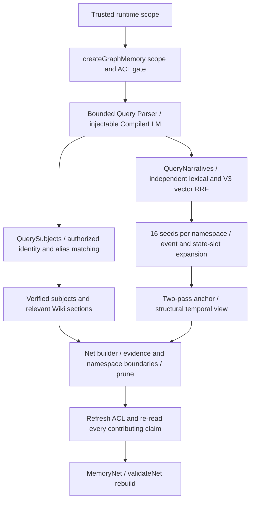

# Graph Memory V3 — Part 1 驗收報告

本次範圍為 `Message → QueryPlan → authorized Wiki/Edges → MemoryNet`。未進入 Part 2，未接 Storyteller，未修改 AG-UI／Python memory envelope，未部署 GCP，未呼叫付費模型或使用正式憑證。

- 指定基準與開始時 HEAD：`476004ac214573a8e7f4be6fed087cefb374ee07`。
- 分支：`codex/graph-memory-v2`，直接承接基準，沒有 reset、stash 或覆寫使用者修改。
- 實作與測試產物 commit：`db726e2727250f81d8b98c46eb24aeb7f87687a3`。本報告以後續文件 commit 保存。
- 原有文件刪除、`host-config.yaml`、`tests/runtime.json` 與未追蹤輸入計畫書均保留且不納入本次提交。盤點見 `artifacts/graph-memory-v3-part-1/verification/workspace-inventory.log`。

## 實作路徑



1. `query-types.ts`、`query-parser.ts`、`time-expression.ts`：獨立 strict Query schema，不套用 Ingest Evidence schema。共用文字、ref、TimeExpression primitives。Query 不接受 subjectId、namespace、ACL、任意 UTC timestamps；名稱、aliases、時間原文及 Narrative 必須是 query 的實際字串片段，ref 必須可解析。允許純 Subject、純 Narrative、空 plan 與多 Narrative。Parser 的無效 JSON、截斷、超限、timeout／abort 回傳 `fallback` 和 unknown plan，沒有任何入庫副作用。
2. `query-temporal-resolver.ts`：使用可信 reference 的年份／IANA timezone 解算日曆日期、區間、as-of、上週三、跨年與事件前後。缺年／anchor、不合法日期或多個不可比較 anchor 保留 uncertain。先召回 anchor Narrative，再以已授權 Edge 有效時間解析相對約束。沿用 Temporal View 的 current／history／as_of、同時刻／重疊／disputed 語意，不以 recordedAt 排事件。
3. `structured-retriever.ts`：Subject 只用各自名稱做 identity/alias 查詢；Narrative 各自 Lexical + Vector RRF，不要求 Subject 交集。Subject 命中給 soft boost。Seed 先於 supporting 排序，按 eventId／stateSlotKey 擴展；每個 Narrative 的時間只套用其種子及關聯事件／slot，事件以 namespace + eventId 分組。
4. `memory-net.ts`、`net-builder.ts`：typed subjects、sections、edges、events、provenance／evidenceRefs，保留 relation／direction、semanticHash、certainty、attribution、有效時間、visibility／namespace、seedScore、querySeeds、seed/supporting 和 partial／warnings。Wiki 僅取相關屬性片段，排除純名稱條目；同 Wiki 不重複載入整頁。
5. `graph-memory.ts`：新增受信 `structuredQuery`、`validateNet`，沿用同一 WeakSet issued scope、authorize、期限與前後授權檢查。不增加 HTTP/browser endpoint；既有 GraphMemoryPort.query/write、GraphQuery/GraphHit 與 Graph Browser 不變。`validateNet` 只接受原服務發出的 Net object，以私有保存的 plan 重讀重建，忽略呼叫者修改的 claim 內容，拒絕偽造／序列化後傳回／不同 scope 的 Net。
6. `query-config.ts`、`provider.ts`、`types.ts`：沿 bootstrap 現有 registry.graph → loadWiki/loadDurableWiki 路徑驗證 `retrievalMode: v2|v3`，預設 v2；V3 另需明確的 server-owned queryParser model 設定，使用既有 CompilerLLM HTTP adapter。讀取旗標獨立於寫入 graphCompilerVersion。實際 provider 設定接線已以本機 HTTP mock 測試，不只測 Zod schema。Part 1 的 v3 開關啟用內部 structured service，既有文字 query 仍走 V2，Runtime 消費 Net 留待 Part 2。
7. `parser.ts`、`relation-abstractor.ts`、`v2-types.ts`：Ingest optional timeExpression；保留 timeText、anchorRef、原有 UTF-16 quote/span 驗證與舊 fixture。新增 optional relationType／relationLabel，保留 legacy relation；新語意使用 related_to 時仍有具引文支持的 from/to/narrative refs。新欄位納入 semantic hash，未使用新欄位的舊 Edge/hash 不回寫。
8. `edge-embedding.ts`、`ingest-cli.ts`：可讀固定模板以 Description、授權 Subject names、有效時間與原時間文字為主；Query 與 Edge 共用時間格式函式。V3 key 加上 `edge-narrative-v3`，不與 V2 model/dimension/version 索引混用。V3 CLI bounded backfill 可重試／續跑；model/template/content hash 不符及未回填時回退 lexical。rebuild 僅刪本 namespace + model/template key，不刪其他版本。

## 相容、預算與授權

不新增 011 migration：可選 relation 欄位沿既有 Edge JSON；QueryPlan／MemoryNet 不建立持久事實表，向量仍用 graph_edge_embeddings。SQLite／PG 共用既有 store abstraction 與授權讀取。升級後可讀舊 JSON；舊版本 strict Zod reader 不能讀新增欄位，因此 rolling upgrade 必須先更新 readers，再啟用新寫入欄位。回退舊 reader 前應停止新欄位寫入；不承諾任意舊執行檔可直接讀新 JSON。

每個 Edge 經 V2RetrievalStore.read 的來源有效性、原文、Bot／project／owner 授權與 Subject 檢查。Wiki 經 activePage + validateRead(activeRequester=true) 並檢查來源／讀取 Bot 的 retained policy。共用現有 beforeQuery 的 ACL refresh/reconcile。所有 namespace 的外部 embedding await 結束後，對整個 Net 再 refresh／重讀，避免 shared namespace await 中撤銷 private 來源卻留下早先組裝的 claim。validateNet 會重新查詢，不保留撤銷 claim 或舊 view。

有界限制：Query 4,096 UTF-8 bytes、Parser output 16,384 bytes、12 Subjects／8 Narratives、每個 namespace 16 seeds、每次 expansion 256、既有 related siblings 128／每 Edge evidence 96、向量每 namespace/model 4,096、Net 64 Edges／64 Subjects／96 provenance／16 Wiki sections／65,536 bytes；supporting event edges 每組最多 8。Wiki pages 16／每頁 sections 4。截斷標 partial + reason；不能安全讀完的 store budget 採 unavailable。Net 是內部資料，並未宣稱符合 Part 2 的 signed context byte/base64 預算。

## Fixture 驗收與 V2 對照

所有驗收模型及 encoder 都是 deterministic mock；Compiler、Publisher、SQLite／PG store、Query Parser contract、Net builder 和 HTTP adapter 使用真實程式碼。

| 場景 | 實際結果 |
|---|---|
| A：Bob 如何處理搜尋推薦服務延遲？ | 同一事故 5 Edges、完整 evidenceRefs、1 關鍵 Wiki section（支援版本回滾）；不虛構 Bob 代 AI 草擬文件 |
| B：先 profile 再 incident | 維持實際 fixture 的 8 Subjects／6 Wiki Pages；cache／access 共用 FeatureHub Wiki；不注入無關 TTL 或純 Bob 條目 |
| C：11/05 v1、11/12 v2 | current=v2；history 保留兩筆；as_of 11/06=v1；沒有刪除原 Fact |
| D：Subject-only／Narrative-only／empty／Wiki-only | 都合法；無 Subject 不阻止 Narrative recall；純 Wiki 具有實際來源參照；空 Net 合法 |
| E：回滾前／上次 | 真實發布的 prior state 可經兩次檢索得到；未知或不可比較事件保持 uncertain，不猜 today |
| F：兩次相隔十天事故 | 10 Edges 分成 2 Event groups；兩次 rollback 有效時間相差 10 天且不互相覆蓋 |
| G：自訂 relation | maintains／responsible_for 沒有新增 legacy enum；方向、Evidence 和新 label 都保存 |
| H：失權與撤銷 | scope copy／跨 Bot／偽造 Net 被拒；撤銷與 Bot disable 重驗證不洩漏；跨 namespace embedding await 中撤銷也清空 claim |
| I：索引相容 | V2/V3 key 共存、失敗後續跑、版本 mismatch、未回填 lexical fallback、撤銷與指定版本 rebuild 驗證通過 |
| J：不合法模型輸出 | JSON／array／bytes／refs／捏造人物或日期／quote／timeout／abort 不會產生入庫事實 |

計畫書 B 的「7 Subjects／6 Wiki Pages」與既有模型不一致：單獨事故是 7 Subjects；先匯入 profile 會另保留 access component，合計 8。沒有刪除既有 Subject 或降低舊斷言來湊數。

`retrieval-comparison.json` 在同一真實發布 fixture、同一問題比較：V2 回傳 5 Facts + 6 個以 Bob／搜尋服務標題或名字為主的 Wiki fragments；V3 是 3 seeds + 2 supporting edges、1 個回滾能力 section。以 fixture 的 5 條預期事故 Edge 為分母，seed recall=60%、展開後 Edge recall=100%、事件群組 precision=100%、每 Edge evidence coverage=100%。這是 fixture contract 指標，不是通用語意／真偽評測；A 的最終 Net JSON 為 11,433 UTF-8 bytes，沒有 partial。

## 測試與保存產物

| 驗證 | 結果 |
|---|---|
| 最終完整 CopilotKit，單 Worker、SQLite + 隔離 PG | **30 files / 170 passed / 0 failed / 0 skipped**；231.97 秒 |
| V3 四檔 targeted（Parser／Net／PG／設定 HTTP adapter） | **14 passed**；17.57 秒；後續最終完整 suite 亦包含全部案例與 budget 斷言 |
| V3 + V2 Retrieval／PG／Graph Browser targeted | **6 files / 34 passed / 0 failed** |
| Build（tsc + Vite） | **passed**；51.57 秒；既有 chunk size warning |
| 最終 tsc --noEmit | **passed** |
| scripts/check | **17 項中 16 passed，僅既有 no-tmp failed（7 findings）** |
| 最終 code health | **0 blocking / 0 advisory** |
| PG migration | 新隔離 DB 001–010 apply passed；009/010 replay 兩輪 passed |
| 指定基準紅測 | 獨立 archive 上 Query 測試因缺少新模組 failed，證明新功能尚不存在 |
| Git whitespace | passed |

初輪紀錄沒有隱藏：預設 Node 啟動失敗、沙箱 localhost listen EPERM、尚未配置 PG 時的 skipped、初輪新程式 CC 超標與十天 fixture reference 設定錯誤，均在後續修正／相容執行環境重驗；完整 suite 最終無 skip。全組 migration 直接重播遇到原有 001 schema already exists；因此 apply 與 009/010 的 idempotent replay 分開報告，未宣稱 001 可重播。no-tmp 的同樣 7 處在基準檔案重現，見 baseline-no-tmp.log。未擴大 timeout、降低斷言或新增 lint 豁免。

必要 JSON 由測試執行產生並標 `mockLLM: true`：

- `artifacts/graph-memory-v3-part-1/query-a.json`
- `artifacts/graph-memory-v3-part-1/net-a.json`
- `artifacts/graph-memory-v3-part-1/temporal-c.json`
- `artifacts/graph-memory-v3-part-1/relation-new.json`
- `artifacts/graph-memory-v3-part-1/vector-index-compat.json`
- `artifacts/graph-memory-v3-part-1/retrieval-comparison.json`

`verification/` 保存每階段命令日誌、初輪診斷、最終 suite/build/typecheck/check、基準紅測、原有 no-tmp 重現與 migration apply/replay。舊 V2 retrieval-a/retrieval-c/featurehub.md 保持原樣。

主要命令（Node 22.18.0；PG 測試 URL 僅指隔離本機 DB）：

```bash
npm --prefix examples/copilotkit test -- --maxWorkers=1 tests/graph-v3-query.test.ts tests/graph-v3-net.test.ts tests/graph-v3-config.test.ts tests/graph-v3-postgres.test.ts
npm --prefix examples/copilotkit test -- --maxWorkers=1 --reporter=verbose
npm --prefix examples/copilotkit run build
examples/copilotkit/node_modules/.bin/tsc --noEmit -p examples/copilotkit/tsconfig.json
.venv/bin/python scripts/check
```

完整修改清單見實作 commit；主要檔案為 `examples/copilotkit/server/graph-memory.ts`、`server/graph/{query-types,query-parser,query-temporal-resolver,time-expression,query-config,structured-retriever,memory-net,net-builder,parser,relation-abstractor,v2-types,edge-embedding,ingest-cli,provider,types}.ts`，以及四個 `tests/graph-v3-*.test.ts`、README、design notes 和驗收產物。

## 剩餘風險與停止點

1. 未驗正式 GCP／IAM／Cloud SQL／GCS／真實模型；PG + FilesystemGraphObjects 和本機 HTTP mock 不等於正式雲端驗收。未重跑原生 Python Hermes suite 或 Chrome UI E2E；本次沒有改 Python／UI，Graph Browser HTTP／資料契約已在完整 Node suite 回歸。
2. Query Parser 採保守 literal spans，避免捏造 actor；模型的事件選擇與意圖仍需未來實際模型品質評估。未支援的自然語言日期或含多個不同比較 anchor 會 uncertain；沒有 bi-temporal truth inference。既有 V2 時間欄位與 legacy day-time 表達不批次改寫。
3. V3 使用 bounded vector scan 與逐筆來源重驗證，未做大資料量效能／負載 benchmark。超過既定工作／來源預算可能 unavailable；大型 namespace 應另做 DB 原生候選設計，不能直接調高上限。
4. V3 Edge 向量需管理員依 namespace 執行現有 ingest CLI vectors 回填；新事實在回填前以 lexical 召回。CLI V3 Edge batches 可續跑，但原 Wiki vectors 命令仍保留原有重建語意。沒有背景自動把 V2 Edge vectors 當 V3 使用。
5. validateNet 需要同一受信服務保留原 Net object；跨程序應重新以已授權 query 建 Net。Part 2 必須在 Storyteller await 後再次使用重驗證結果，並處理 Story grounding、可見性分拆及 signed envelope 總 bytes。
6. 17 項 scripts/check 的 no-tmp 基準問題未修，不能宣稱 lint 全綠。既有 migration 001 不是直接重播型 SQL；部署仍須既有 migration ledger，並遵守 readers-first 的 JSON rolling upgrade 順序。

Part 1 到此停止。沒有啟動 Part 2 或正式部署。
