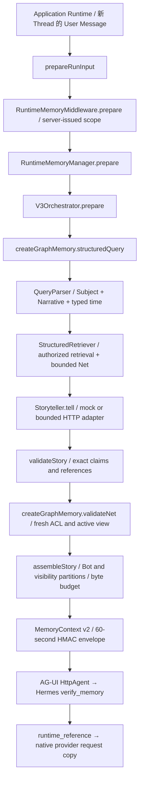

# Graph Memory V3 — Part 2 實作與驗收報告

## 1. 範圍與 Git 基準

承接使用者已完成／驗收的 Part 1，開始時 HEAD 為 `afde2e67b53d5684792d6447ffcc03d7f53fe9a6`，分支 `codex/graph-memory-v2`。實作、測試與驗收產物提交：`c9710c74d2316ac5a20dfaaa13496f92de0a180b`。本報告以後續文件提交保存。

完成 `Message → authorized MemoryNet → grounded Story → signed reference context → native Hermes provider request`。沒有重新實作 Part 1 Parser／Net，沒有修改 Python memory schema、system prompt、AG-UI 公開協定或新增 Agent tools，也沒有將 Story 寫回 Graph。

開始時既有的 Cloud Native 文件刪除、`host-config.yaml`、`tests/runtime.json` 修改，以及未追蹤的舊計畫書均保留，不納入本次提交。盤點見 `artifacts/graph-memory-v3-part-2/verification/workspace-inventory.log`。工作區因此不是全乾淨；不得將其當作本次未提交的實作。

## 2. Changes 與實際 call chain



- `server/memory/story-types.ts`：strict Zod Story schema，claims／edge IDs／Wiki revision refs／confidence，拒絕未知欄位和偽造 provenance。
- `story-validator.ts`：`groundedStory()` 生成 deterministic 候選；`validateStory()` 檢查輸出 bytes、完整 claims multiset、reference、confidence，以及 summary 必須等於 claim texts 的換行組合。每個 claim 限一個 Edge 或一個 Wiki section，因此不能用多事件 refs 拼成新因果。
- **明確設計取捨：本版採 extractive Story。** 模型可以重排原有 claims，不能自由改寫人物、日期、因果，也不能新增 events／warnings 的自由敘述。這比單純驗證 ID 更保守；自然語言 paraphrase 的語意正確性並非機器 reference 檢查能保證。模型品質與自由敘事仍是已知限制，不宣稱已實現通用無幻覺摘要。
- `storyteller.ts`：可注入 `CompilerLLM`，使用獨立 timeout、token 配置及最多兩個 in-flight calls。格式、引用、內容、timeout 或容量失敗皆使用 deterministic Story。忽略 abort 的模型占用原 slot，防止連續 timeout 啟動無限呼叫。
- `v3-orchestrator.ts`：沿用受信 `structuredQuery`／`validateNet`；模型完成後重建整個授權 Net。Net 有任何變化就丟掉所有生成文字，從 fresh Net 重建，不能沿用撤銷前的 summary。相同 reference 在 private/shared copies 出現時，以完整 canonical claim multiset 分配實際 Net item，保留各自 namespace。
- `story-context.ts`：以 source Bot／visibility 分組，保留原 session/document sources、Edge event/time/attribution/view、evidence refs 和原文 quote。合併重複 heading／record provenance，逐整條 claim 驗算 context bytes；超限不截斷 quote、不刪最後 supporting evidence，標 `partial`。
- `deadline.ts`、`graph-memory.ts`、`retriever.ts`：傳遞同一 AbortSignal；即使 provider 忽略 cancellation，deadline 仍可結束等待。V2 query timeout 維持原值；structured 階段另有預設 5000 ms 上限，Runtime end-to-end 預設 8000 ms。Parser／空 Net 的 V2 fallback 也受剩餘 Runtime signal 約束。
- `runtime-memory-manager.ts`、`application.ts`：在既有 middleware 接入 orchestrator。`provider.ts`／`query-config.ts`／`types.ts` 沿既有 bootstrap → registry.graph 接上 server-owned Storyteller 設定，無瀏覽器輸入的 ACL／Net。
- `middleware.ts`：沿用 Bot/Thread/Run 綁定、60 秒 HMAC；新增送出前 payload 長度檢查。`prepareRunInput()` 的 resume／前端 forwardedProps 保護與原生 reference fencing 不變。

## 3. E2E trace 與 Fixture 證據

所有模型、embedding 與最終 Agent 回覆均為 deterministic mocks；Compiler、stores、Parser、Net、middleware、AG-UI 與 Python verifier 使用實際程式碼。

### Incident A：Session ingest → 另一 Thread → 原生 Hermes

實際 query：`Bob 如何處理搜尋推薦服務延遲？`。QueryPlan 包含 Subject `Bob`、Narrative `搜尋推薦服務延遲`、`explain_cause` 和 `history`。Profile + meeting 的真實 Session provenance 為 `source-thread`；查詢使用新的 `new-thread`／`new-run`，不依賴舊 conversation history。

最終 Net 是一個 Event、5 條 Edges 和一個有用 Wiki section。完整 IDs、時間、每個 claim 的 evidenceRefs／quote／sources，以及 Story 原文存於 `incident-run.json` 和 `net-story-evidence.json`。

| Story claim 原文 | 引用與限制 |
|---|---|
| 隔天 Bob 把 FeatureHub 回滾到舊版，延遲隨即恢復 | rollback Edge 及其原文 quote，保留 structured effective time |
| 上週搜尋推薦服務的延遲飆高，原因是 FeatureHub 的快取失效 | degradation Edge；事件時間為上週，不以 recordedAt 代替 |
| 11/3，會議中，Alice 報告上週搜尋推薦服務的延遲飆高 | Alice reported_issue Edge |
| 會後由 AI 助理草擬了事後檢討文件交給 Alice | 兩個不同方向／關係的 Edges，個別 evidenceRefs；保留 uncertain，沒有改成 Bob 撰寫 |
| 存取層支援版本回滾／FeatureHub 的存取層 | 有 revision 的 Wiki section；未加入 TTL 或純人名 heading |

Story summary 是上述 claims 的原文換行組合；完整正文已保存，並非額外未引用的 narrative。signed record content 含 `# Recalled Memory (untrusted reference)`，每條 Edge 的 metadata 保留 event ID、confidence、view、time、attribution 和原始 quote。

同一 fixture／問題／4096-byte ContextAssembler 的最後一輪量測：

| 指標 | V2 baseline | V3 |
|---|---:|---:|
| Context JSON UTF-8 bytes | 4074 | 3826 |
| 必需事故 Edge recall（5 條為分母） | 2/5，40% | 5/5，100% |
| 本機單次 Mock latency | 105.87 ms | 151.06 ms |

V3 在保留完整事故證據下少 248 bytes（約 6.1%）；V2 片段有部分標題／純名稱，且較大的 Fact JSON 擠掉其他事故 Edge。這是 fixture 的單次觀測，不是負載 benchmark、p50/p95 或真實 LLM latency。原始 baseline context 和量測保存在 `incident-run.json.comparison`。

### Temporal C、雙事故與撤銷

- `temporal-run.json`：真實發布 v1（11/05）與 v2（11/12）；current 得 v2，as-of 2026-11-06 得 v1，history 保留兩筆。structured effective-time view 決定 ordering，不以 embedding similarity 或入庫時間決定版本。
- `multi-incident-run.json`：同一 Bob 的兩次事故相隔十天，Net 有兩個 event groups／10 Edges；在明確配置的 8192-byte context 內保留兩組全部 Edge IDs、各自來源及 event IDs。一般預設仍是 4096 bytes，超量採 whole-claim pruning 並標 partial，不宣稱所有大型 Net 都可完整裝入預設預算。
- Storyteller pending 中撤銷 source、disable Bot、改變 retained owner ACL 均不保留舊 Story；Bot disable 明確拒絕，source／ACL 失效重建後移除 claims。Bot A private 不給 B；明確 share 後 B 可以讀合法 shared，sources 仍指 A；不同 principal 查無資料。

### 最終 Gate：已檢查實際原生 provider request

`tests/fixtures/graph-v3-probe.ts` 實際 ingest profile + meeting（`source-thread-a`），建立 V3 provider／Storyteller，從 `new-thread-b`／`story-run` 呼叫 `createApplication().runtime()`，經既有 AG-UI HttpAgent 到原生 Hermes。

`tests/hermes_agui/test_runtime_memory.py` 的新增 parametrized case 檢查 native provider request 中有 `story:`、`FeatureHub`、`source-thread-a`、`Bob 把 FeatureHub 回滾` 及 `untrusted reference`；同時確認 SQLite durable messages 沒有 reference record ID。最終 Agent 文字是 Mock，驗收判準是實際 injected signed reference 進入模型請求，而不是 Mock 回覆碰巧正確。

`native-provider-validation.json` 記錄這些 assertion 與 canonical runner log hash；`signed-envelope-validation.json` 則保存 Node 產生的 envelope 經真正 Python `verify_memory()` 接受，以及 forged Run／tampered signature 被拒絕的結果。沒有保存簽章金鑰或完整 envelope token。

## 4. Security、預算與失敗處理

| 情況 | 行為與測試 |
|---|---|
| V3 off／V1 namespace | 沒有 structured service 或沒有 structured Net 時使用既有已授權 V2；Graph Browser 和 Legacy suites 保留 |
| Parser timeout／invalid output | V2 graph.query + 原 assembler；internal observer 提供 `v2_parser_fallback` status |
| Embedding 不可用／未回填索引 | 沿 Part 1 lexical/subject fallback；Part 1／V2 regression 全部重跑 |
| Storyteller 不可用／timeout／無效內容 | deterministic Net-to-Context；不存在 Edge ID、角色反轉、日期改寫、無引文因果、來源指令和偽造 provenance 被拒 |
| 空 Net | 可回退保守已授權 V2 fragments；無內容則合法空 context |
| read／revalidation unavailable／deadline | 空記憶，不使用 stale Story |
| 明確 unauthorized／scope forgery | 拒絕；不呼叫 V2 作為越權重試 |
| source／Bot／ACL 改變 | post-model validateNet 重讀；變更即丟棄整份生成 prose |
| 併行 Runs | 不共用 Run 授權決策或 envelopes，各自綁 Thread／Run |

上下限：Part 1 Net 65536 bytes；包含 candidate 的總模型 input 98304 bytes；Story output 32768 bytes；Story schema 最多 80 claims。Runtime 最長 15000 ms 的受信配置、Story timeout 最長 5000 ms，沒有無限 retry。

Context JSON 預設 4096、硬上限 8192 bytes；最多 20 records／每 record 20 sources，內容上限保守預留 heading 後仍低於 16384 characters；base64url payload 最多 16000 characters。測試包含多位元 UTF-8、超大內容、25 個 sources、partial、private/shared/source-Bot 分組與簽章綁定。來源仍使用既有 session/document ProvenanceSchema，沒有假造 `kind: story`。

## 5. Verification 與產物

環境：macOS x64、Node 22.18.0、Python 3.14.6、隔離本機 PostgreSQL 16 fixture + FilesystemGraphObjects。Python 環境透過 PM 建立；未以 raw pip/uv 修改 Hermes 環境。測試後已停止本次啟動的隔離 PG。

| 驗證 | 最終結果與日誌 |
|---|---|
| 完整 CopilotKit，單 worker，含 Part 1／V2／PG／Browser／Cloud Tasks | **32 files / 182 passed / 0 failed / 0 skipped**，150.64 秒；`full-suite-complete.log` |
| V3 Story／Runtime／PG targeted | **13 passed**；`story-runtime-pg-final.log`；其後 provenance 修正由 `provenance-final.log` 和最終 full suite 覆蓋 |
| Python 原生 memory verifier／AG-UI／native provider targeted | **7 passed / 0 failed**，222.8 秒；`python-memory-native.log` |
| Build（tsc + Vite） | **passed**；`build-complete.log`；既有 chunk size warning |
| 最終 tsc --noEmit | **passed**；`typescript-complete.log`（無診斷輸出） |
| scripts/check | **17 項中 16 passed**；只有既有 no-tmp 的 7 findings failed；`check-final.log` |
| code health | **0 blocking / 0 advisory**；`health-final.log` |
| Base red | archive 開始時 HEAD 執行新 Story contracts，因缺少 Storyteller 模組 failed；`base-red.log` |
| Git whitespace | passed；`whitespace.log` |

初輪失敗均有保留：Python subprocess import path、新增 timeout helper 的 TypeScript 參數、empty-Net/V1 偵測破壞 Part 1 contract、sources >20 在 pruning 前進入 schema，以及已撤銷資料無 Storyteller 呼叫的 Bot-disable fixture。均已修正後重驗，沒有降低原斷言、提高 timeout 掩飾問題或靜默 skip。

環境診斷也保留：沙箱 localhost／shared-memory EPERM、原 `.venv` 缺 `ag_ui`、PM 首輪 DNS／TLS／損壞 cache。使用隔離環境及 certifi 信任庫後完成驗證；`python-environment-certifi.log` 記錄 PM 的 cache 修復及成功結果。no-tmp 與 Part 1 報告的同樣七處一致，未改任務外設定。

所有 JSON 在 `artifacts/graph-memory-v3-part-2/`：必要的 `incident-run.json`、`temporal-run.json`、`net-story-evidence.json`、`signed-envelope-validation.json`、`fallback-cases.json`，另含雙事故及 native-provider 驗收。`verification/acceptance-summary.json` 是機器摘要；`verification/sha256.json` 是所有產物的 SHA-256 manifest。失敗日誌中的完整 signed payload／signature 已遮蔽。

主要命令（PATH 指向相容的 Node 22；DB URL 僅指隔離本機 fixture）：

```bash
npm --prefix examples/copilotkit test -- --maxWorkers=1 tests/graph-v3-runtime.test.ts tests/graph-v3-storyteller.test.ts tests/graph-v3-postgres.test.ts
npm --prefix examples/copilotkit test -- --maxWorkers=1 --reporter=verbose
npm --prefix examples/copilotkit run build
examples/copilotkit/node_modules/.bin/tsc --noEmit -p examples/copilotkit/tsconfig.json
HERMES_PYTHON=<isolated-PM-test-python> scripts/run_tests.sh tests/hermes_agui/test_runtime_memory.py
.venv/bin/python scripts/check
.venv/bin/python scripts/check --only health
```

## 6. Operational、回退與限制

設定沿 server-owned `registry.graph`：`retrievalMode: v3`、原有必填 `queryParser`；可選 `storyteller: {baseUrl, model, keyEnv, timeoutMs, maxTokens}`，預設 1500 ms／2048 tokens；`runtimeDeadlineMs` 預設 8000，可設 100–15000。不配置 Storyteller 時使用 deterministic 摘要。金鑰仍只放在指定 secret environment variable。

一鍵 read-path 回退：將受信設定改為 **`retrievalMode: v2` 並重啟 server**。`graphCompilerVersion: v2` 不改，既有 V1/V2 與 Browser 保留。Part 2 沒有新增 migration、事實表、持久 Story 或 embedding template；Part 1 的 `edge-narrative-v3` 索引版本／namespace-specific backfill 和 readers-first JSON 升級規則不變。未建立／未回填 V3 vectors 可走 lexical，不能冒用 V2 vectors。無需執行新 migration 或刪舊索引作為 Part 2 rollback。

已知限制／not run：

1. 真實 LLM smoke、GCP／Cloud SQL／GCS／正式 IAM、Chrome UI E2E 均 **not run**；沒有使用正式憑證、付費模型或自動部署。PG + FilesystemGraphObjects 不等於正式雲端驗收。
2. extractive Story 只接受已授權文字的重排，尚未開放自由 paraphrase／生成式事件摘要；Mock 不代表真模型推論品質。
3. latency 是單次小 fixture 觀測；未量測真模型 p50/p95、大資料負載與效能 SLA，沒有保證 2 秒完成。
4. V3 native E2E 驗證 interactive path；managed/delegated 使用同一 prepareRunInput/middleware，既有 delegated／managed 回歸通過，但未逐一新增 V3 原生端獨立驗收。
5. 產物預算可能捨棄低順位完整 claims，並標 partial；大型 Net 不保證完整召回鏈全部進入預設 context。Story 仍是低信任參考資料，不是新的權威事實或授權來源。
6. scripts/check 仍有已知 no-tmp 基準失敗，不能宣稱所有 lint 全綠。

Part 2 到此完成並停止；沒有自動部署雲端。
