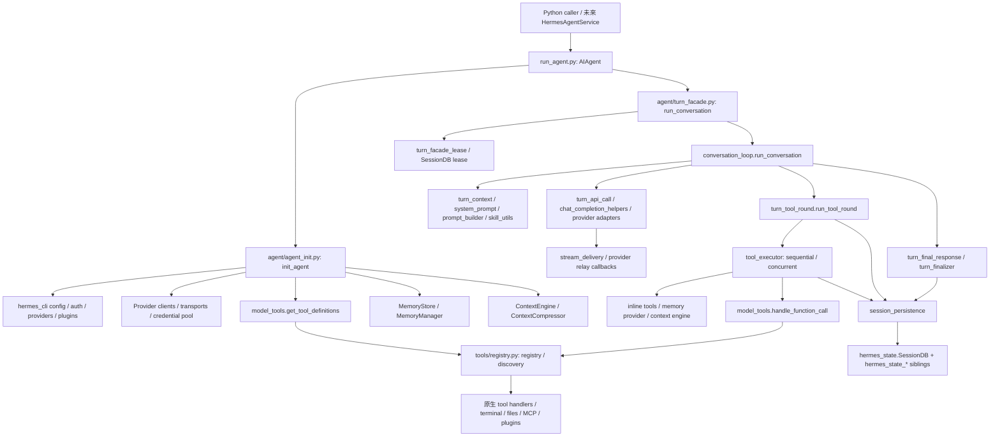

# Phase 0：Hermes Headless / AG-UI 架構盤點

## 1. 範圍、版本與結論

本文件依 `IMPLEMENTATION_PLAN.md` 執行 Phase 0，僅分析與規劃，未實作 Adapter、HTTP Server 或改寫 Agent Loop。

- Checkout：`4a642267c88e520a51a0d11cbd557411df6c3412`，commit 日期 2026-11-13，訊息 `add:plan`。
- 本地 origin：`git@github.com:jiangweitaiwan/hermes_agui.git`；不是 NousResearch upstream remote。
- 已閱讀 [NousResearch upstream main 的 run_agent.py](https://github.com/NousResearch/hermes-agent/blob/main/run_agent.py)；main 是移動參照，本報告的函式與行號以**本地 SHA**為準，未宣稱兩者完全相同。實作前應另行核對欲追蹤的 upstream SHA。
- 方法：實際閱讀 facade、初始化、turn phases、provider relay、tool executor、SQLite persistence 與 scope 實作；以下為靜態呼叫追蹤，沒有執行真實模型、工具或端到端測試。

**結論：可以透過薄 Adapter 建立 Headless Agent。** `AIAgent` 已可直接從 Python 建立並同步執行，無須啟動 CLI REPL、GatewayRunner 或 messaging adapter。需要保留 `hermes_cli` 與部分 `gateway` 套件的 library 依賴；「不啟動 UI」不等於「可刪掉 UI 所在目錄」。

一般工具已提供帶穩定 ID 的開始／完成 Callback；文字有經過過濾的 delta Callback。主要缺口是完整的訊息邊界、非正常工具路徑事件、Run lifecycle、執行緒橋接、外部身分與 Session ownership。它們應由 Adapter 負責，不能另造 Agent Loop。

## 2. 真實模組依賴圖

箭頭表示 import、委派或執行呼叫；不表示要啟動被引用套件的服務。

沒有計畫書假設的 `agent/callbacks.py`；Callback 分散於建構參數、stream delivery、tool executor 與各 provider relay。`agent/context_engine.py` 是抽象介面，實際引擎選擇在 `agent_init._select_context_engine` / `_build_context_engine`；不能用新歷史截斷器替代它。

## 3. 初始化與 Headless 可重用範圍

### 初始化路徑

1. `run_agent.py::AIAgent.__init__`（約 240 行）將參數轉交 `agent/agent_init.py::init_agent`（2056 行）。公開介面已接受 `model/provider/api_mode/base_url/api_key`、toolsets、callbacks、`session_id/session_db`、`platform/cwd`、credential pool、memory manager、iteration/run budgets。
2. `init_agent` 設定 route、api mode、credential pool 與 Callback，初始化控制／stream／usage 狀態與 logging。
3. `_build_client` 選 provider client；OpenAI-compatible、Anthropic、Bedrock、MoA 與其他 transport 路徑各有處理。不能只包裝 `OpenAI.chat.completions.create`，否則會繞過既有 routing、fallback 與認證。
4. `_load_tools`（994 行）觸發 migration recovery、plugin discovery，再以 `model_tools.get_tool_definitions` 與 `toolsets.agent_tool_surface` 決定 session 工具表，建立 `valid_tool_names`。工具會受 config、可用性與平台 policy 影響。
5. `_init_session_state`（1079 行）接受外部 ID，否則用 `hermes_state_ids.new_session_id` 產生 `YYYYMMDD_HHMMSS_<6 hex>`；建立 sessions log 目錄、checkpoint manager、每 agent TodoStore。`session_db` 可注入，**建構子不保證自動建立 durable DB**。
6. `load_config_readonly` 讀取原生設定；`_init_memory` 載入 built-in MemoryStore 與可選 MemoryManager/provider；`_build_context_engine` 初始化 context engine，保留其 session lifecycle。
7. system prompt 主要在第一次 turn 的 `turn_context.build_turn_context` → `conversation_loop._restore_or_build_system_prompt` 建立或恢復；`agent/system_prompt.py` 組合 identity、memory、工具說明、platform hints、skills index／auto-load、context files。不能誤以為建構完成就已固定全部 prompt bytes。

### 可獨立執行，但仍有 library 依賴

| 元件 | 不啟動 CLI / Gateway 是否可用 | 條件 |
|---|---|---|
| AIAgent、原生同步 loop / provider transports | 可以 | 原生 runtime、設定、憑證與 provider backend 已準備 |
| Registry、dispatch、terminal / filesystem tools | 可以 | 保留 backend、approval、task/session scopes；工具權限另行限制 |
| MemoryStore / MemoryManager | 可以 | 綁定正確 home/profile；實際 provider 可能有外部服務 |
| Skills discovery / prompt / context engine / compression | 可以 | 保留 profile skills 路徑、workspace 與 prompt caching 生命週期 |
| SessionDB / messages / lease / resume | 可以 | 由 host 管理 DB 生命週期並傳入 Agent |
| clarify、approval、UI-specific tools | 需介面 policy | 不得回退到 terminal input；MVP 可明確拒絕尚不支援的互動 |
| Gateway 平台投遞、cron 通知等 | 不是自動繼承 | 不啟動 Gateway 時沒有對應 delivery host；另列非 MVP 能力 |

### Import-time 與啟動副作用

- `run_agent.py:15` 起會在未載入 `hermes_cli.main` 時執行 `_early_recovery.restore_interrupted_pull()`，必要時 relaunch。
- `run_agent.py:99` 起取得 home 並 `load_hermes_dotenv`，包含 project `.env`；此為 process 環境副作用，不能每次 request 動態換 `.env`。
- `model_tools.py` import 時執行 builtin tool discovery／自註冊；registry、plugin registry、tool definition cache 等包含 process state。
- 初始化會設 logging、建立磁碟目錄、讀 memory/config、探測工具／plugins，部分 provider 會啟動 keepalive。`quiet_mode=True` 主要控制顯示，不能當作「無副作用模式」。
- `run_agent` 依賴 `hermes_cli.env_loader/config/auth/providers/timeouts/observability`；初始化與 Session context 亦引用 gateway helper。保留這些檔案即可，不必啟動 CLI／Gateway。

## 4. 一次 User → LLM → Tool → LLM → Final 的追蹤

正式入口使用 **`AIAgent.run_conversation`**，不可直接呼叫 loop sibling，否則會跳過 admission、lease、accounting 與 cleanup。

1. `agent/turn_facade.py::TurnFacadeMixin.run_conversation`（22 行）接受 `user_message`、`conversation_history`、`task_id`、`stream_callback` 等；建立 turn identity、取得 durable turn lease、建立 relay conversation/turn 與 accounting／interrupt scopes。
2. `agent/conversation_loop.py::run_conversation`（1809 行附近）包裝 `_run_conversation_turn`，統一輸出 `turn_id/current_turn_user_idx`，處理退出／held final 等收尾。
3. `agent/turn_context.py::build_turn_context`（1193 行附近）準備 request context、使用 caller history、恢復 rotated session、hydrate Todo/usage、固定或恢復 system prompt、加入 user message 並準備持久化。普通路徑在 1275 行從 `conversation_history` 複製 messages；不能只重用 agent instance 就假設下一次自動沿用歷史。
4. `_run_conversation_turn`（1647 行）執行原生 phase pipeline：`begin_iteration` → `prepare_iteration` → `assemble_api_request` → `run_preflight_gate` → `_run_api_retry_loop` → `perform_api_call`。while 由 max iterations、shared iteration budget、grace call、interrupt 等控制。
5. `agent/turn_api_call.py::perform_api_call` 決定 streaming；`agent/chat_completion_helpers.py::build_api_kwargs`／`interruptible_streaming_api_call` 或 `interruptible_api_call` 走對應 transport。OpenAI-compatible 最終呼叫 client completion；其他 api modes 使用各自 adapter。保留 request middleware、retries、fallback、timeout 與 usage tracking。
6. `turn_response_intake.normalize_model_response`／response check 正規化 response。若有 tool calls，進入 `turn_tool_round.run_tool_round`：驗證、展開 batch、dedupe、normalize IDs、`stage_tool_call_message`，加入 `assistant(tool_calls)`，**先持久化再執行有副作用工具**。
7. `agent/tool_executor.py::execute_tool_calls_sequential`／`execute_tool_calls_concurrent`（以及 segmented 調度）執行：解析參數／scope／middleware／approval；`_begin_tool_execution` 發送帶 ID 的 start callback。inline tool 走 `INLINE_TOOL_EXECUTORS`（例如 memory / todo）；context engine 與 memory provider 自有工具走各自 handler；其餘走 `model_tools.handle_function_call`（902 行）→ `tools.registry.ToolRegistry.dispatch`（1084 行）→ 原生 handler。並非所有工具都穿過 model_tools。
8. `_commit_tool_result`（1080 行）觀察／轉換結果、保存大結果、附 subdirectory hints、轉模型相容 content，建立 `role=tool, tool_call_id=...` message，append 並 flush DB；一般成功提交路徑再發 `tool.completed`，之後 `_emit_tool_complete_and_risk` 發帶 ID 的完成 callback。
9. tool round 執行原生 post-tool compression 等收尾後回到 while；下一次 LLM request 包含 assistant tool calls 與配對 tool results。
10. 無 tool calls 時進入 `turn_final_response.finish_text_response`；stop gates、truncation／continuation 等仍可能要求繼續。最終走 `turn_finalizer.finalize_turn`、持久化與資源收尾，回傳 `final_response`、`messages` 等 dict。

錯誤、interrupt、budget exhausted、compression deferred 等也可能直接回傳 dict。Service 必須檢查 `failed/error/partial/interrupted/completed/failure_reason` 等實際欄位組合，不能將「函式正常 return」視為 Run 成功，也不能把 tool error 一律視為 Run error（模型可能繼續處理）。

Loop 是同步的；provider stream relay、工具 worker 會另外開 thread。未來 async host 應將**整個公開 turn 入口**放到有界 worker executor，保留 contextvars；不能在 FastAPI event loop 直接執行。

## 5. Callback 與 AG-UI 語意映射

以下事件名稱是計畫書的預期映射，**尚未驗證官方 SDK schema／版本或 CopilotKit 相容性**；Phase 2–3 才鎖定。Phase 1 先保留 Hermes callback 契約，不新增 AG-UI dependency。

| 現有注入介面與來源 | 實際 payload / 限制 | 建議用途 |
|---|---|---|
| `stream_delta_callback(text)`；`StreamDeliveryMixin._fire_stream_delta` / provider relay | 可見文字 delta；經 thinking／memory-context scrubber；無 message ID、start/end | 直接作 `TEXT_MESSAGE_CONTENT` 的內容；Adapter 管理 message lifecycle |
| run-level `stream_callback(text)` | 轉交本次 turn stream sink | 和建構時 delta sink 擇一，避免相同文字送兩次 |
| `interim_assistant_callback(text, already_streamed=bool)`；`stream_delivery._deliver_interim` | 中途 assistant/commentary；有 dedup 提示 | `already_streamed` 時只收束既有 bubble；否則才補內容 |
| `tool_start_callback(call_id, name, args)`；`tool_executor._begin_tool_execution` | 已解析、供顯示的完整參數，穩定 call ID | 一般呼叫的 `TOOL_CALL_START`、一次完整 `ARGS`、`END`（args 完成） |
| `tool_complete_callback(call_id, name, args, result)`；`_emit_tool_complete_and_risk` | 一般已提交結果；blocked 不發；結果可為字串或 multimodal | 經輸出 policy 後 `TOOL_CALL_RESULT`；不可當 final answer |
| `tool_progress_callback(event, name, preview, args, **kwargs)` | started/completed/risk/reasoning/MoA 等混合事件；completed 有 result/duration/is_error，但不保證 ID | status／輔助觀察；不能以工具名稱關聯多個同名呼叫 |
| `tool_gen_callback(name)`；`stream_delivery._fire_tool_gen_started` | 只有名稱，無 call ID／argument delta | 僅顯示生成中，不足以建立正式 tool call |
| `step_callback(api_call_count, previous_tool_round)`；`turn_iteration_prep.prepare_iteration` | iteration 開始；沒有對稱 step finished callback | 可選 step event，end 由 Adapter 補齊 |
| `status_callback(kind, message)`、notice callbacks | 等待、重試、通知 | 可選狀態；不當成模型文字或 run failure |
| `event_callback(event, payload)` | `conversation_compression.py` / `codex_runtime.py` 的 session compression 等 | 不是通用 agent event bus；只白名單轉換 |
| `reasoning_callback(text)`、`thinking_callback(text)` | 內部推理／狀態混合，可能含 scratchpad | 不轉為公開文字事件；不得外洩 Chain-of-Thought |
| `tool_result_metadata_callback(id, name, args, result)` | append 前準備 display metadata，非 durable completion 通知 | 若需呈現 metadata 可用；不可據此提前宣告成功 |

### 缺口與排序

- `RUN_STARTED/FINISHED/ERROR` 由 Service entry／return／exception 建立；其語意涵蓋整次 native turn，工具失敗可仍有成功 final。
- 文字 callback 沒有 provider attempt／message boundary。不能把整個 Run 的所有 delta 當成一則 final，因為可能有工具前 commentary、重試、continuation 與 held/transformed output。Adapter 必須處理分段／去重；若既有 callbacks 無法可靠分辨 provider response 邊界，才提議在既有 stream response 邊界增加**可選觀察介面**，不修改 loop 判斷。
- 並無通用的增量 tool args Callback。完整 args 到達時一次輸出即可；不能宣稱是真正增量。
- blocked、parse error、invalid tool name、skipped/interrupt 工具可能不走 complete callback。保留 canonical assistant/tool rows 作補帳依據，依 call ID 去重；run-level 補帳可滿足正確性，但未必能即時呈現每個異常結果。若後續驗收要求即時，應加在既有 canonical append/flush 後的窄 observer seam，不能只包 `handle_function_call`。
- 一般工具 start 可在 worker thread，complete 通常由 executor collector 在提交結果後發；stream 可在 provider relay worker。不可假設所有 callback 同 thread，或「收到 complete 的順序就是工具實際完成順序」（concurrent executor 按原呼叫順序 append results）。
- native callbacks 多數吞掉 callback exception，因此 Queue overflow／bridge failure 必須另設可觀察狀態並主動 interrupt，不可依賴 raise 穿透 Loop。未來以 thread-safe handoff 接 async bounded queue；run 關閉後 fence 掉遲到事件。
- 顯示參數有 redaction，但不是對外資料授權保證；原始結果可能含機密、大檔、圖片或 instruction metadata，需 transport output policy。

## 6. Session Persistence 與恢復契約

### 原生實作

- `hermes_state.py::SessionDB`（464 行），constructor（584 行），預設 DB 路徑由 profile-aware home 計算；SQLite connection 使用 `check_same_thread=False` 配合原生 lock／write transaction／read connections，journal policy 在 `hermes_state_wal.py`，不能簡化為「所有主機固定 WAL」。`AsyncSessionDB` 是既有 async facade，不能因此把同步 Agent 當 async。
- Host 傳 `session_id` 與 `session_db`；`AIAgent._ensure_db_session` 首次使用時保存 source、model/config、system prompt、profile、user/routing metadata。外部 ID 可接受，但不是授權憑證。
- `SessionPersistenceMixin._persist_session`（509 行）保存 `_session_messages`，經 `_flush_messages_to_session_db` 增量寫入；以 message persisted markers／row identities 去重，不是每輪 replace 全部 messages。
- `hermes_state_messages.py::append_messages_batch` / `get_messages_as_conversation`（1522 行）處理 canonical transcript 與 resume；還包含 inactive／compacted rows、repair、lineage 與 row IDs。不能直接 SQL 讀 content 拼成純文字歷史。
- `resolve_resume_session_id` 解析 continuation tip；`conversation_loop._restore_or_build_system_prompt` 恢復 pinned prompt/tools；compression 經原生引擎與 durable fences。`event_callback` 可反映 compression，但外部 thread ID 不應隨內部 session tip 改變。
- `agent/turn_facade_lease.py::admit_durable_turn_lease`（300 行）在 load→run→flush 周圍提供跨程序 lease；TTL 300 秒，等待上限 1800 秒，有 refresh／liveness。DB 缺席或不具 lease API 時不提供該保護。競爭／缺少 history 等情境會在 admission 後重新讀取最新 transcript；host 不應自行在 lease 外把舊 snapshot 覆蓋回 DB。
- `run_agent.py::close`（949 行）釋放 memory provider、task／child／client 等資源，清除歷史引用。session end／memory extraction 不等於每個 HTTP request 結束；應在真正 eviction／shutdown 時執行，並綁定 owning profile。

### 建議 Adapter ownership

1. 外部 `(principal, profile, thread_id)` 映射到 host 產生的原生 session ID，預留 authorization resolver；不把任意 threadId 直接拿來查 DB。
2. Hermes DB 是模型歷史權威；前端完整 messages 不得與 DB 無條件串接。Phase 1 只接受本次新 message，留 request ID 去重與後續 reconciliation seam。
3. 每個 session 保有自己的 agent/cache/lifecycle state，同一 session 串行；跨 session 不共用同一 AIAgent instance。共用 registry／DB handle 要遵循原生 scope／ownership。
4. DB-native lease 繼續保留；host 的短 admission queue／bounded executor 避免同 thread 大量請求佔住所有 worker 等待 1800 秒。不要另造 DB lock 協定。
5. 回傳並記錄執行後的 canonical `agent.session_id`、結果 history 與 turn boundary；以原生 API 處理 resume／compression，不自行修補 message list。

## 7. 多使用者與並發風險

| 風險與實際來源 | 影響 | Phase 1 決策／驗證 |
|---|---|---|
| AIAgent mutable state：callbacks、interrupt、prompt cache、Todo、compressor、provider clients | 跨 thread 共用 instance 會串 context／取消錯 run | 每 session 一個 instance；同 session host lock + 原生 DB lease |
| MemoryStore 的 MEMORY.md / USER.md、skills roots 是 profile-scoped | 不同 session 仍可能共用長期記憶／技能；這是原生設計 | 區分 thread history 與 principal/profile 隔離，不把同 profile 當不同租戶沙箱 |
| import dotenv／launch home／os.environ fallback | process 啟動狀態可能被其他 profile 誤用 | 啟動時固定 runtime；request 不修改環境變數或 `os.chdir` |
| `model_tools._last_resolved_tool_names`、registry／plugins／availability caches | global state 不等於 per-session state；委派期間可暫時 stale | 保留 agent 自有 tools snapshot，不從 global 推導授權；冷啟動 discovery 避免並發 reload |
| profile scope 與 thread hops | 非同步 callbacks／executor／flush 若失去 contextvars，讀到 launch profile | 用 `agent.runtime_scope.bind_state(scope_for_profile(...))` 與 token reset；傳遞 copy_context |
| `agent.secret_scope` multiplex guards | 未啟用 multiplex 時不會 fail closed | 多 home host 啟用 `set_multiplex_active(True)`，scope 包含建構、run、eviction、shutdown |
| session/task/tool backend caches；本機 terminal／filesystem 權限 | 不同歷史不代表不同 OS 權限，工具可共享 workspace | 明確 cwd／task/session scope；不以 HTTP threadId 宣稱 sandbox；跨租戶需 backend/process 隔離 |
| approval／clarify／UI tools | 可能等待無人可回答的互動或觸發 CLI fallback | 注入有限時、明確 unsupported/deny policy；不能預設 yolo |
| SQLite 單 writer、lease wait／provider／工具 threads | 寫鎖競爭與 worker starvation | 有界並發／queue、壓力測試、原生 timeout/journal policy |
| interrupt 是協作加 worker propagation，不是 Python thread 強制終止保證 | client 斷線後工具／外部程序可能仍跑 | `agent.interrupt(..., hard_cancel=True)` + 等待 cleanup；超時執行隔離，不能只 future.cancel |
| debug request dumps／trajectories／logging | prompt、工具內容可能落磁碟 | 運維限制目錄與保留期限；不把 logs 或 raw DB transcript 當公共 API |
| PM／provider extras／lazy install | 乾淨 server image 缺 backend、啟動時下載或互動 | 用既有 PM 預備 runtime；先不刪 dependencies，後續實測 wheel/container |

可重用的 scope seam：`agent/runtime_scope.py`、`agent/secret_scope.py`、`agent/runtime_cwd.py`、`hermes_constants` home override。`gateway/run.py::_profile_runtime_scope` 已透過 `bind_state(scope_for_profile(...))` 組合 home、secrets、terminal policy，是可讀的既有消費者，不需要為了 scope 啟動 GatewayRunner。

Cancellation 現有公開介面在 `agent/interrupt_control.py::InterruptControlMixin.interrupt`；lease loss/watchdog 也呼叫 hard cancel。Service 取消必須指向正確 active run，避免上一輪的 delayed cancellation 影響下一輪；本階段未驗證所有 provider／非合作工具的最壞退出時間。

## 8. Phase 1 詳細修改清單（待確認後才實作）

Phase 1 定義為純 Python headless service + 原生能力契約測試；不新增 SSE／AG-UI event encoder／CopilotKit example。基本 session routing 必須先有，完整 AG-UI reconciliation 留 Phase 4。

| 檔案 | 預定內容 | 驗收重點 |
|---|---|---|
| 新增 `hermes_agui/__init__.py`、`hermes_agui/core/__init__.py` | 最小公開匯入，不在 package import 啟動服務 | import 不啟動 CLI/Gateway/server |
| 新增 `hermes_agui/core/factory.py` | 用原生 config/provider resolver 與 AIAgent constructor；注入 callbacks、DB、session/cwd/toolsets；建構在 owning scope 下 | 不自行組裝 LLM client、tool registry、memory／prompt；保留原生 resolution precedence |
| 新增 `hermes_agui/core/service.py` | 提供 `run(session_id, message, ...)` 概念 wrapper、結果狀態正規化、callback sink、active-run cancellation、close/evict | 只呼叫公開 `agent.run_conversation`；不複製 while 或 dispatch |
| 新增 `hermes_agui/session_manager.py` 的最小骨架 | ownership resolver、外部 ID 映射、每 session agent lease／history ownership、bounded cache；重啟用原生 resume | 同 session 序列化、不同 session 不混 history；保留 native durable lease |
| 新增 `hermes_agui/execution_manager.py` 的最小骨架（若需 async facade） | 有界 worker executor、contextvars propagation、取消／shutdown join | async caller 不被同步 loop 阻塞；無失控 background jobs |
| 新增 `tests/hermes_agui/test_headless_agent.py` | 真實匯入 service/AIAgent/registry/SessionDB，fake provider 回應與安全 temp 工具 | 下列行為契約；測試路徑遵循 tests/AGENTS.md 的 source mirror 規則 |
| 新增 `tests/hermes_agui/test_session_lifecycle.py` | temp DB resume、兩 session、並發 admission／cancel、scope/lifecycle | 不依賴真實 API；不寫使用者 home |
| 視需要更新 `pyproject.toml` package discovery、`uv.lock` | 現有 setuptools include 沒有 `hermes_agui`；加入新 package 才能 wheel 安裝 | wheel smoke import；依 PM 規範 `hermes pm lock`；Phase 1 無 AG-UI/FastAPI 新 dependency |
| 更新本文件或新增 `docs/agui-architecture.md` | 確定 wrapper 契約、history ownership、限制、執行方式 | 文件區分既有 API 與新 API |

**預設不修改的核心檔案：** `run_agent.py`、`agent/conversation_loop.py`、turn phases、registry/dispatch、Memory、Skills、ContextEngine、SessionDB。先用現有 callbacks 與結果補帳證明可行。

**條件式最小改動：** 若 contract test 證明工具異常路徑或 response boundaries 無法從現有介面可靠觀察，提出限定在 `agent/tool_executor.py` 或既有 stream lifecycle sibling 的 observer 變更。新增可選 constructor 參數時才同步修改 facade／`agent_init.py`／`agent_init_params.py`；必須遵循大小／複雜度 ratchet，不把新行為塞回 facade。observer 不改變 messages、執行順序、工具表或 system prompt；其必要性先以測試證明。完整 AG-UI 即時事件缺口不應阻擋純 headless Phase 1，也不能暗中提前重構 loop。

### Phase 1 驗收矩陣

1. **無 UI 啟動**：隔離 subprocess、temp HERMES_HOME/runtime/workspace，真實 import／初始化 AIAgent；stub provider transport，不執行 CLI/Gateway entrypoint，stdin 不可讀；不得只 mock 整個 AIAgent。
2. **純文字**：provider 固定回應，`final_response` 正確、native user/assistant history 落 DB；兩次 flush 不重複。
3. **Tool → LLM**：fake provider 首次回 tool call，真實 registry dispatch 安全測試 handler，第二次 request 實際包含配對 assistant/tool rows；驗證 ID 與 callback result，final answer 由第二次模型回應產生。
4. **串流**：fake transport deltas 到達注入 callback，回傳完整 final；不將同一文字從兩個 sink 重複投遞，不輸出 reasoning。
5. **多輪／重啟**：同 session 第二輪可見第一輪；關閉 service 後重建並從原生 DB 恢復，保留 row identity／無重複 user message。
6. **隔離／並發**：A/B session 的 provider requests 無對方 history；同 session 第二個 run 序列化；多 profile 驗證 config、memory、skills、secrets、cwd 及 shutdown 都使用 owning scope。
7. **失敗／取消**：provider exception、tool error、blocked／invalid args、DB flush failure、取消等待與取消執行中 turn；保留原生錯誤語意，native lease 可釋放，不把非合作工具誤報為已終止。
8. **保留能力**：原生 Memory tool／Skills index 或 skill load／context engine hooks 可用；普通多輪 prompt 和 tools snapshot 固定，原生 compression 後 conversation 仍合法。測行為而非讀 source 或做 change-detector。
9. **生命週期／包裝**：eviction 與 shutdown 正確 close，session end 不在每輪觸發；wheel 安裝可匯入新 package；provider extras 已事先備妥。

預定指令：`scripts/run_tests.sh tests/hermes_agui/`；針對修改涉及的既有 agent／session 測試再跑相關檔案，並執行 `python scripts/check`。實作時依 tests/AGENTS.md 用 PM 建置測試環境；不使用裸 pytest 或 pip/uv 改 Hermes 環境。

## 9. 風險、待確認與本階段驗證

- **高優先**：Session history 的 runtime ownership、profile scope 與取消生命週期；避免以不同 threadId 冒充不同使用者隔離。
- **中優先**：tool blocked／parse/skipped events、文字 response 邊界、callback 被吞錯、queue backpressure；Phase 1 建立 native contract，Phase 3 再完成協定排序。
- **待動態確認**：乾淨 Python/PM runtime 的 import 與 provider extras、背景執行緒資源上限、各 backend cancellation、實際 memory provider/session end 行為。`pyproject.toml` metadata 允許 Python >=3.11,<3.15，但現有依賴 markers 與註解指向 3.14 runtime；不能只據 metadata 選 3.11 部署。
- **後續階段**：官方 AG-UI Python SDK/CopilotKit 版本、Request/Event schema 與 terminal event 規範，應在接入前查官方來源並鎖版；本文件沒有把計畫書的概念 JSON 當成已驗證協定。
- **設定衝突處理**：計畫書部署章提議 host/port/session/logging 等 env vars，但 root AGENTS.md 禁止新增非秘密行為的 HERMES_* env config；實作採原生 config.yaml／適當 CLI flags，只有 secrets 進 .env。

Phase 0 已完成 source-level User → LLM → Tool → LLM → Final 路徑與介面盤點。沒有執行測試套件或真實模型，因此通過／失敗數量不適用；不宣稱 Headless／AG-UI 整合已通過動態驗收。本次僅新增本文件，未新增依賴、刪除模組、修改 loop、建立 commit 或部署。等待 Phase 0 確認後才開始 Phase 1。

## 10. Phase 1 驗證後補充（2026-11-14）

Phase 1 自使用者確認後開始，base 為 `fa65202`（`add:phase 0`）。實作與測試報告見
[phase-1-report.md](phase-1-report.md)，使用介面見 [agui-architecture.md](agui-architecture.md)。

進一步追蹤確認：原生 lease 只在 contention 時自動 reload；Adapter 在 lease 外先讀 DB
仍可能在「另一 writer 恰於 read 與 acquire 之間提交」時使用舊 history。因此 Phase 1
為公開 turn facade 增加 `reload_history=False` 可選項，Headless caller 設 True，沿既有
admission 的讀取路徑在 lease 內載入。未改寫 Loop，也未更動預設 caller-owned history 行為。

另確認 checkout 缺少原生 runner 必需的 `scripts/ci/list_os_marked_tests.py` 與 code-health
pattern 檔；Phase 1 補回這兩項 upstream dependency。完整 CI helper 仍有缺檔限制。
`setup.py` 也明確禁止一般 wheel build，因此 Phase 1 改用 PM editable 安裝與 checkout 外
匯入驗證；Phase 0 所提一般 wheel smoke 不應透過繞過 native build guard 完成。

Caller context 的動態契約另抓出 `gateway.session_context.set_current_session_id` 仍會更新
共用 `os.environ`，即使 turn 已包在私有 Context。Phase 1 對此 helper 增加 multiplex
模式的 ContextVar-only 路徑，單一 CLI 與 delegation 的既有語意以回歸測試保留。
