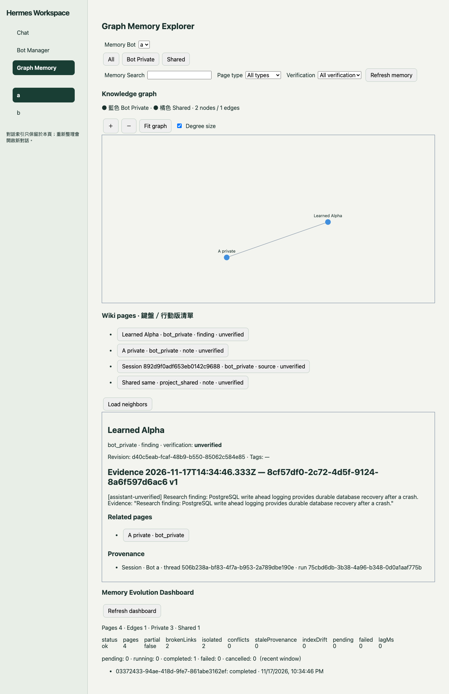

# Frontend Workspace Part 3 — Graph Memory Explorer

日期：2026-11-17。基線 commit `792bc4892cbd489584425707a2a15e2ec52d52d3`，開始時工作目錄乾淨。
未 commit 或 push；沒有呼叫付費 API。

## 前置核對與範圍

已讀總計畫、Part 3 計畫、Part 1/2 完成報告、根與 tests AGENTS.md、example README、
package/lockfile、Workspace／BotManagement、Graph Browser DTO／API、既有 native evolution probe。
前兩階段的 Workspace、managed login/logout、Bot lifecycle 與 scoped read-only Browser API 均存在；
本期重新執行完整 Node、瀏覽器及 `tests/hermes_agui` 回歸，不以舊報告當成本次結果。
example 無額外區域 AGENTS.md。沒有更改 Hermes core、prompt、model tools、GraphMemoryPort、
retrieval ranking、session SQLite schema、production ACL 或 production HTTP API。

## 完成項目

- `frontend/api/graph.ts` 共用既有 DTO，唯讀 GET、no-store、AbortSignal，區分 unauthorized 與 disabled/unavailable。
- `MemoryExplorer` 整合側欄 Graph Memory，提供 Bot selector、All/Bot Private/Shared、FTS Search、type／verification 篩選。
  keyed session 在 Bot/scope/query/filter 變更時卸載並中止舊請求；active guard 阻止慢回應復活。
  登出、失去 Bot 或離開 Graph 會移除全部 explorer state；不保存 localStorage 或 private response cache。
- `GraphView`：SVG force layout、有限 160-frame simulation、最多 API window 的 100 nodes、API edges、
  平移、拖曳、縮放、fit、degree size、visibility 色彩及文字圖例、node selection 與一層鄰居查詢。
  cleanup 取消 animation。小螢幕隱藏 SVG，使用等價 Wiki 按鈕清單；鍵盤可 Tab/Enter 操作。
- Wiki 列表與搜尋 snippets 沿用 API；分頁明確替換視窗而不合併歷史節點，避免保留撤銷內容。
  truncated／empty／loading／error 都有狀態；Refresh memory 清空 detail 後重新查詢 active revision。
- `WikiPageViewer`／`ProvenancePanel`：GFM Markdown、tags/type/verification/revision、同 namespace 的 related links、
  document title/version/sourceId 或 session bot/thread/run。未提供 raw session/tool/reasoning viewer。
  raw HTML 不執行；禁止 javascript/data 連結、iframe、外部圖片自動載入；外連須手動點擊並設安全 rel。
  Wiki links 只對 API related 中已授權 ID 導航；broken link 明確 unavailable，不猜測內容。
- `MemoryDashboard`：實際 stats、health、近期 jobs 五種 state，partial/lower bounds 與 null unknown 保留。
  可手動 refresh；頁面可見時每 15 秒輪詢、離開停止；錯誤退避至 30–120 秒。
  evolution off 顯示 not available，不假造零或歷史曲線；權限失敗移除已載入記憶。
- Workspace 保留既有 Chat 元件掛載與 thread 行為。新增功能沒有 graph 寫入／share/revoke/delete/ingest/reindex UI。
- 根 README 新增入口，example README 提供 managed + graph + evolution 到建立 Bot／聊天／瀏覽記憶的完整操作。

## 依賴與設計選擇

新增精確版本 `react-markdown@10.1.0`、`remark-gfm@4.0.1`，供 React 19 安全 Markdown/GFM rendering；
未使用 raw HTML plugin。lockfile 由既有 npm 更新；npm 重新整理依賴 hoisting／peer tree，保留既有直接依賴版本。
套件沿用 repository `.npmrc` release-age、ignore-scripts、no audit 配置；沒有執行第三方安裝腳本。
圖譜採小型 SVG force simulation，不新增 canvas graph dependency，沿用 React/Vite 與現有樣式。
僅對最多 100 節點 window 做 O(n²) 有限迭代；不聲稱大型圖效能 SLA。

## 測試證據

環境：現有 Node 22.18.0 darwin-x64、npm/package-lock、Chrome 150、Hermes PM 建立的隔離 test interpreter。
未使用 raw pip/uv 修改環境。所有 LLM/compiler 均本機 fixture/mock；未驗證外部 provider 品質。
Node/build/Playwright 命令於 `examples/copilotkit`；Python／根 CI 於 repository root。

瀏覽器真實整合與故障情境分開驗證；skipped 不視為通過。

| 驗證 | 指令 | 實際結果 |
| --- | --- | --- |
| 完整 Node | `npm test -- --reporter=dot` | 15 files，99 passed，0 failed，75.24s |
| Production build | `npm run build` | 最終通過；9070 modules，1m20s；既有 chunk warning |
| TypeScript | `./node_modules/.bin/tsc --noEmit` | 通過；最終 build 亦含此檢查 |
| Graph E2E | `GRAPH_MEMORY_TEST=1 npm run test:e2e -- tests/browser/memory-explorer.spec.ts` | 3 passed，1.7m；真實 scoped API／native run publication／CLI revoke，另含 route mock 故障情境 |
| 原生全套 | `scripts/run_tests.sh tests/hermes_agui` | 22 files，81 passed／1 failed，400.1s；既有 multi-Bot CLI restart socket timeout；單檔重跑通過 |
| 原生失敗檔重跑 | `scripts/run_tests.sh tests/hermes_agui/test_runtime_entrypoint.py` | 3 passed，pytest 156.72s／runner 297.0s；未改測試或 timeout |
| 完整 Playwright | `npm run test:e2e` | 6 passed／4 skipped，1.8m；模式專屬測試另跑 |
| Managed lifecycle | `DYNAMIC_BOT_TEST=1 npm run test:e2e -- tests/browser/bot-management.spec.ts` | 2 passed，1.0m |
| Multi-Bot | `MULTI_BOT_TEST=1 npm run test:e2e -- tests/browser/multi-bot.spec.ts` | 1 passed；stream/tool/HITL/delegation 隔離 |
| Production Graph | `COPILOTKIT_TEST_PRODUCTION=1 GRAPH_MEMORY_TEST=1 npm run test:e2e -- tests/browser/memory-explorer.spec.ts` | 3 passed，1.0m；含最終 zoom／graph 與 Wiki 各自分頁驗證 |
| Production 全套 | `COPILOTKIT_TEST_PRODUCTION=1 npm run test:e2e` | 6 passed／4 skipped，1.2m；專屬模式已另跑 |
| 根 CI | `.venv/bin/python scripts/check` | 17 checks，10 通過／7 既有阻礙 |

根 CI 仍缺六個腳本：`check_os_marker_fakes.py`、`check_agents_md_size.py`、`check_line_endings.py`、
`check_lazy_deps_imports.py`、`check_profile_archive_boundary.py`、`check_blob_size.py`；health 因根
`package.json` 缺失失敗。沒有新增無關檔案或放寬規則來掩蓋失敗。
直接使用 repository TS metrics engine 與 example TypeScript 檢查 frontend：191 units、max CC 13，無 CC>20、lines>300、nesting>6 finding。

首輪 sandbox Node 有 83 passed／16 failed，均為 loopback listen EPERM；允許本機 fixture 後完整 99/99。
首輪 Python runner 因 sandbox subprocess PermissionError，22 files 無法收集，沒有列為通過；另行允許測試程序後重跑。
Browser fixture 初期因 Host 共用 workspace／credential 與 macOS tmp symlink 拒絕啟動，均修正 fixture，未放寬產品防護。

## 操作、限制與 rollback

依 [example README](../examples/copilotkit/README.md) 啟動 managed Host 與 Runtime，設定 server-owned identity、
核准 templates、graph dataRoot 與 evolution compiler；登入、建立 Bot、完成 Chat、開 Graph Memory。
來源撤銷仍經既有可信 CLI；刷新會重新讀取 active revisions。
Static mode 或 graph 關閉不提供知識；evolution 關閉時 pages/search/network/stats 可用，health/jobs unavailable。
health 為既有 bounded visible-page 診斷，staleProvenance 不代表全庫 stale inventory；jobs 為近期 window。
跨分頁 edge 不會猜測；load more 取代目前頁；沒有歷史統計庫、graph 編輯、檔案匯入或分享 UI。

無 migration。Rollback 回復本期 frontend、package/lockfile、測試與 README，重新 build 即可；
不要移除 WikiStore／immutable Markdown、Bot registry、audit/history，亦不得復活已撤銷的來源。

## 操作畫面

畫面僅含測試 fixture 資料，沒有真實使用者對話或 credentials。

## 驗收補記

原生全套共 22 files，81 passed／1 failed；唯一失敗是原有
`test_multi_bot_cli_restart_preserves_separate_native_histories` socket timeout。
未修改實作、測試預期或 timeout，透過規定 runner 單獨重跑該檔 3/3 通過。
因此記錄初次全套失敗與重跑通過，不將初次全套改寫成一次全綠。

Graph E2E 的真實路徑驗證 native run → durable job → compiler → Wiki/edge/session provenance，
並以既有 `ingest-cli.ts delete` 撤銷實際 source，再刷新確認舊 Wiki 消失。
A/B/C private 與 shared 隔離、同名頁、node click、zoom/fit、type filter、中文搜尋、related links、
惡意 Markdown、mobile/keyboard、logout 均使用真實 Application HTTP／SQLite。
慢回應、分頁與 unavailable／404 則明確使用 route mock 驗證 UI，沒有把 mock 當成真實整合。
測試曾因不符 SessionIngestor 的 40 字與研究內容門檻而沒有 enqueue，改用長篇研究 fixture，保留原門檻。
另修正刷新時 Wiki/Dashboard sibling keys 重複導致殘留元件的問題；最終 Graph 3/3 綠燈。

先前測試 fixture 曾將 Vite 的 `/api/graph.ts` 模組誤攔為 API，造成空白畫面；已縮窄 fixture dispatch，正式 server 路由原本即無此問題。

最終確認：README 操作指南／完成報告／fixture 截圖已寫入；`git diff --check` 與文件 temporary-path lint 通過。
最後僅將 props 的 inline shapes 整理為 interfaces（不改 runtime 行為），TypeScript noEmit 再次通過。
未加入真實 secret，未新增公開 storage HTTP route，未修改 Hermes core；沒有 commit 或 push。
既有 Node SQLite experimental、Python SQLite WAL-reset fallback、Vite large-chunk 警告保留。
